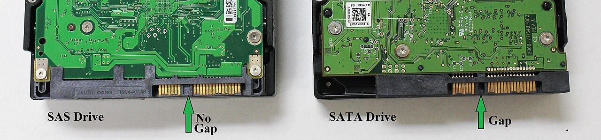

# 硬碟種類與背板｜現場辨識對照

> **用途：** 確認客戶的硬碟插得進、讀得到，並避免熱插拔拔錯顆。
> **原則：** 硬碟能不能用，要看**硬碟介面、背板、控制器（RAID 卡）**三者是否支援。

## 1. 介面種類

| 介面 | 怎麼認 | 說明 |
|---|---|---|
| **SATA** | 接頭的資料段和電源段**中間有缺口** | 便宜、容量大；可以插在 SAS 背板上 |
| **SAS** | 中間缺口**被補起來**，背面多一排接點 | 企業級；**不能插在只支援 SATA 的背板／控制器** |
| **NVMe（U.2 / U.3）** | 2.5 吋外觀，接頭接點更多 | 走 PCIe，速度最快；需要 NVMe 背板或 Tri-Mode 控制器 |
| **M.2** | 小長條 | 多用在開機碟（例如 Dell BOSS、HPE NS204i） |

- **U.3** 背板（Tri-Mode）同一個槽可以接 SAS / SATA / NVMe；**U.2 NVMe 硬碟插在 U.3 槽不一定支援**，要查機型規格。
- 3.5 吋槽可以用轉接托架裝 2.5 吋硬碟，但托架要該機型可用的料號。

*圖片來源：[Gmelander／Wikimedia Commons](https://commons.wikimedia.org/wiki/File:SASvsSATA_Connector.JPG)，CC BY-SA 3.0*

## 2. 硬碟托架（Caddy）

- 托架**各廠牌、各世代不一樣**，例如 Dell 14G 和 16G、HPE Gen10 和 Gen11 不一定通用。
- 客戶自備硬碟時，先確認有沒有附托架。
- 槽位編號多半從 **0** 開始，順序會印在前面板，寫進裝機紀錄。

## 3. 燈號

各廠牌不同，大致是：

| 燈號 | 意思 |
|---|---|
| 綠燈閃爍 | 正在讀寫 |
| 綠燈恆亮 | 正常、閒置 |
| **橘燈** | 故障或預測故障 |
| 綠橘交替／藍燈閃 | 正在 Rebuild 或被「定位（Locate）」 |

## 4. 熱插拔換硬碟

:::danger
RAID 已經降級（Degraded）時，**拔錯另一顆好的硬碟，整組 RAID 會壞掉、資料遺失**。拔之前一定要確認是哪一顆。
:::

1. 在 BMC 或 RAID 管理工具確認故障硬碟的**槽位編號**。
2. 對那顆執行 **Locate / Blink（定位閃燈）**，到機器前面確認是閃燈那顆。
3. 拔出後等幾秒再插新硬碟。
4. 確認開始 **Rebuild**，記錄開始時間；Rebuild 期間不要再動其他硬碟。

## 5. 看不到硬碟時

- 介面不支援：SAS 硬碟插在 SATA 背板、NVMe 插在沒有 NVMe 線路的槽。
- 控制器模式：硬碟要先在 RAID 卡建立 Virtual Disk，或把控制器／硬碟設成 HBA / Non-RAID，OS 才看得到。
- 安裝 OS 時缺 RAID 控制器驅動（見 [伺服器裝機檢查清單](../../checklists/server-deployment.md)）。
- 舊硬碟殘留別的 RAID 設定（Foreign Configuration），要匯入或清除。
