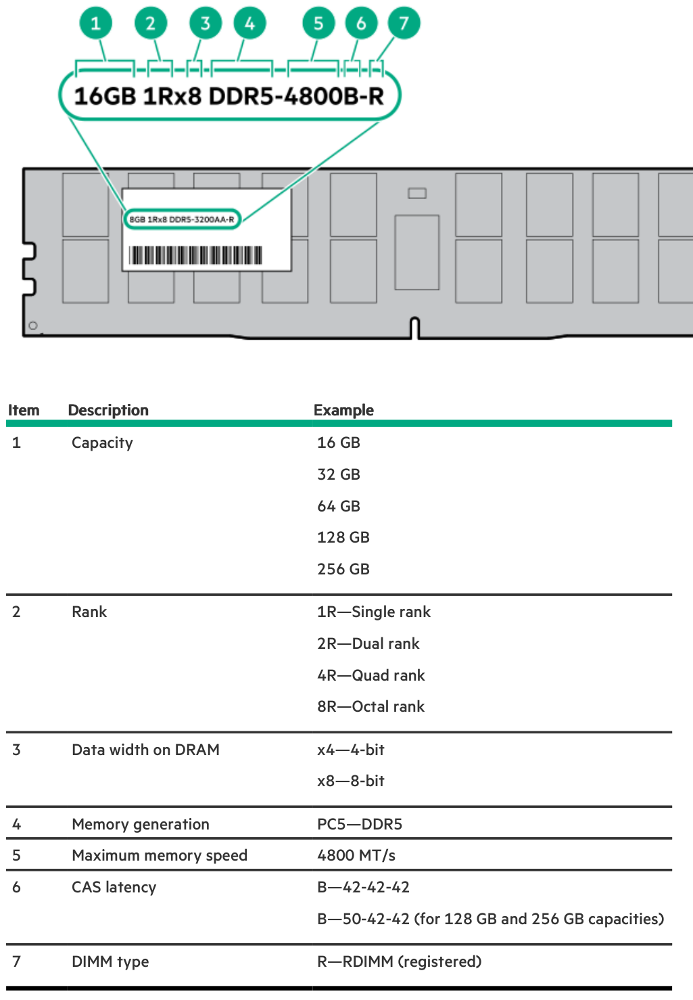
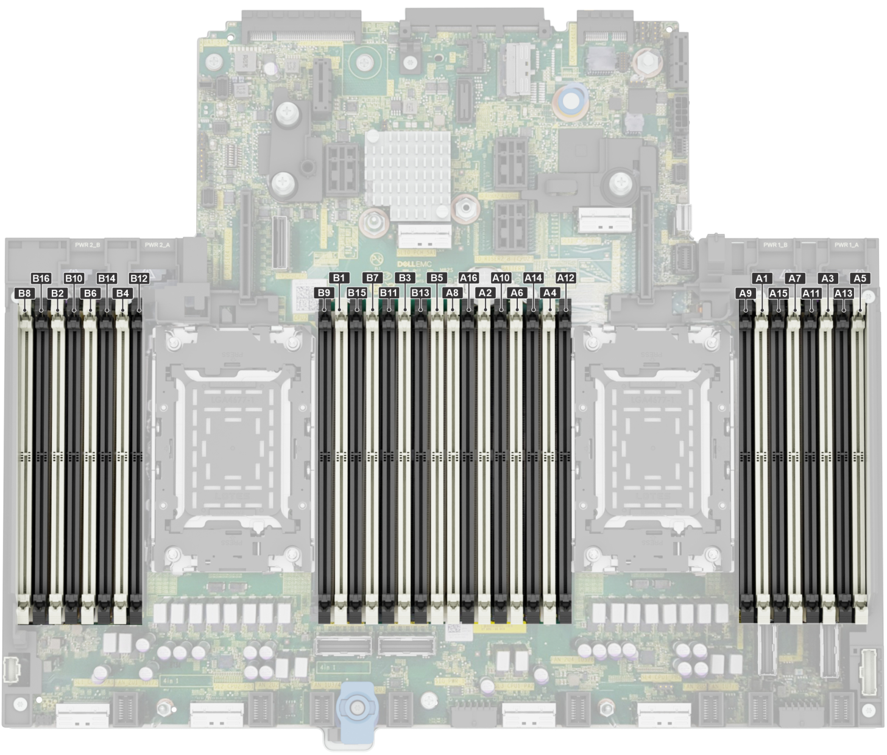
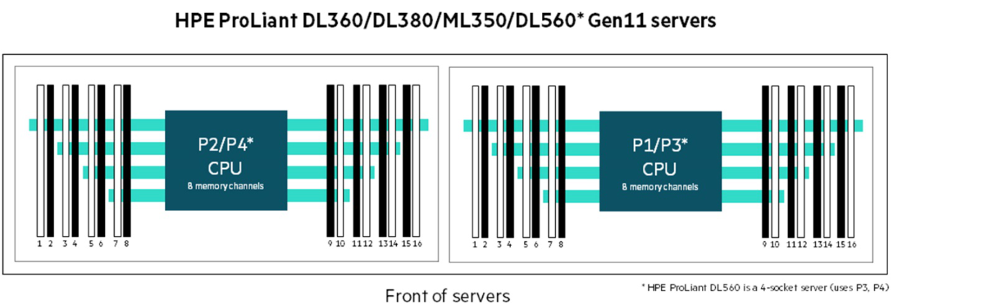
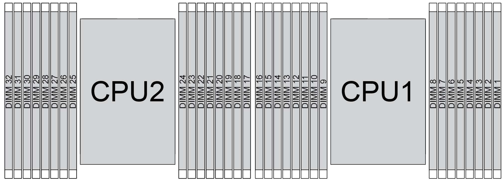
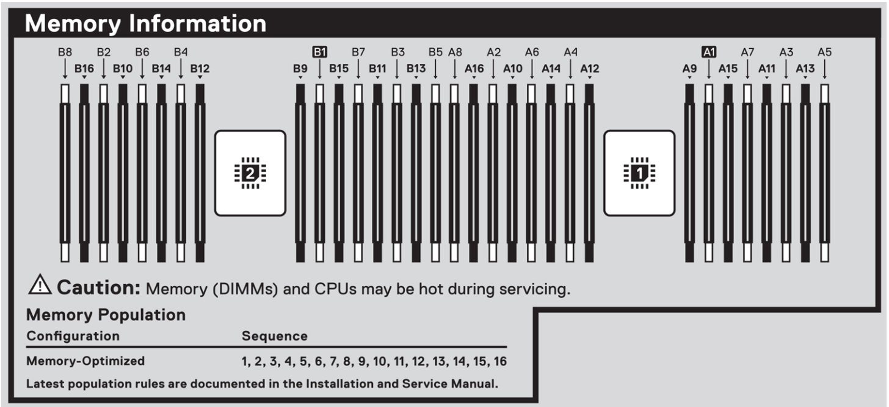
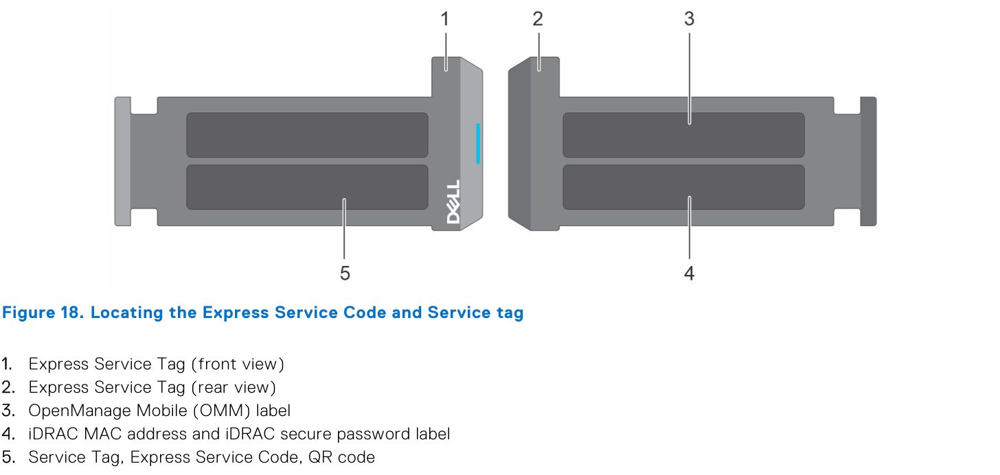
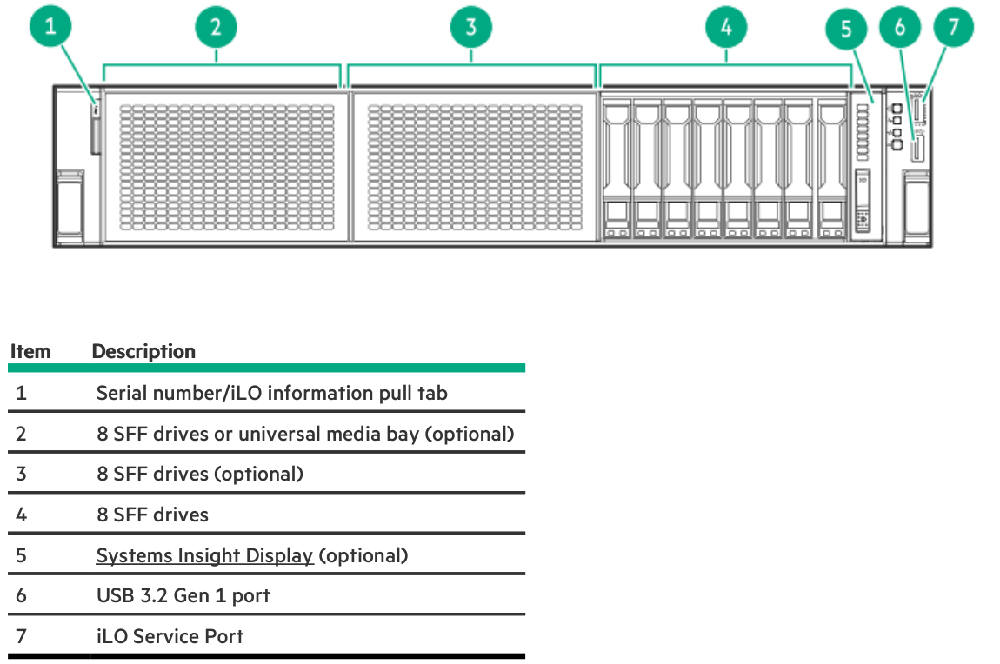
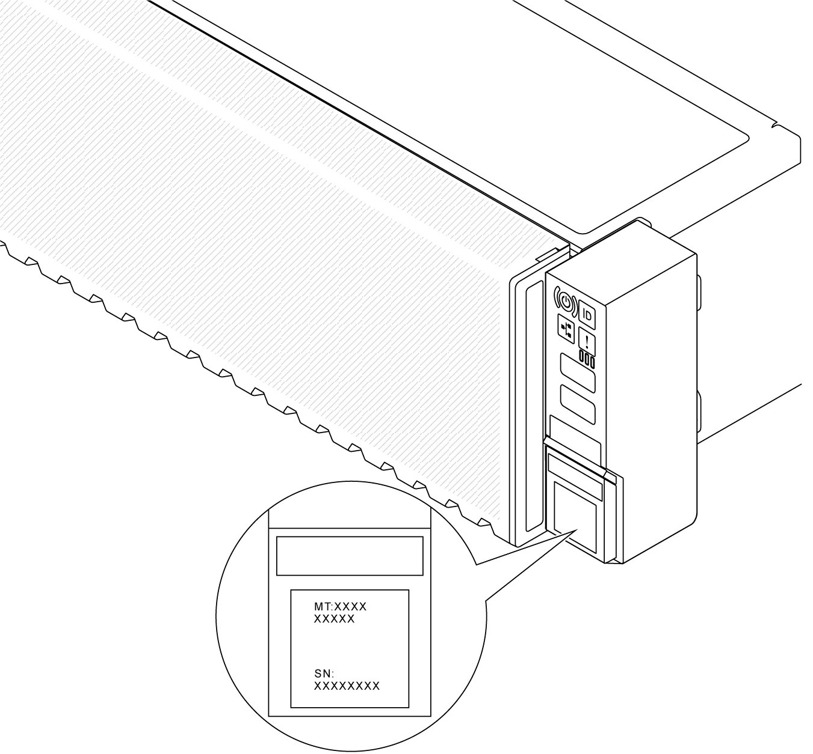
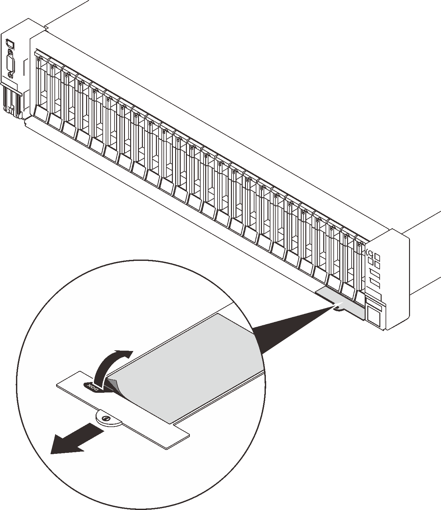
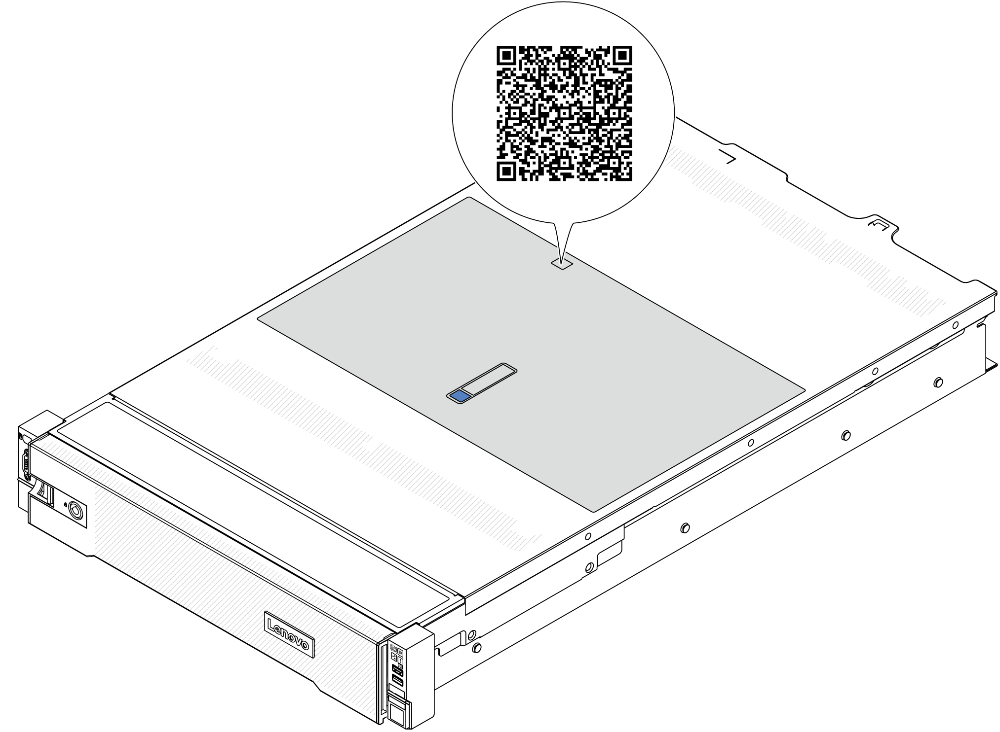

# 伺服器記憶體插法與上蓋標籤

> **用途：** 加裝或更換記憶體時，知道要插哪幾個插槽、怎麼看機殼上蓋的標籤，避免降頻、容量少算或開不了機。
> **資料來源：** Dell、HPE、Lenovo 官方手冊，圖片出處標在每張圖下方（見最後「參考資料」）。第 4 節的插槽順序是**特定機型**的，換機型一定要看該機型手冊或上蓋標籤。

## 1. 記憶體相關名詞

Slot（插槽）的通用說明，以及 DIMM、PCIe、硬碟槽的差別，見 [伺服器的 Slot（插槽）](../server-slots/index.md)。

| 名詞 | 白話說明 |
|---|---|
| **DIMM Slot**（記憶體插槽，Dell 叫 Socket） | 插記憶體的位置；編號方式各家不同，見第 4 節 |
| **通道（Channel）** | CPU 連到記憶體的路。Intel Xeon 第 4／5 代每顆 CPU 有 **8 個通道**（A～H）。每個通道都有插，頻寬才會全開 |
| **DPC**（DIMM Per Channel） | 一個通道插幾支。上面這幾台每個通道有 2 個插槽，所以每顆 CPU 是 8 × 2 = **16 個插槽** |
| **第一槽／第二槽** | 同一個通道的兩個插槽。**第一槽要先插**：Dell、HPE 用**白色**標示（第二槽是黑色）；Lenovo 叫 slot 0 / slot 1 |
| **Rank** | 記憶體上的顆粒分組，1R / 2R / 4R / 8R |
| **RDIMM / LRDIMM** | 伺服器用的記憶體種類，**不能混插** |

## 2. 記憶體條上的標籤怎麼看

每支記憶體上都有標籤，例如 `16GB 1Rx8 DDR5-4800B-R`（HPE 的寫法）或 `32GB 2Rx4 PC5-4800B-R`（`PC5` 和 `DDR5` 意思一樣）。

*圖片來源：HPE ProLiant DL380 Gen11 Server User Guide（[HPE Support Center](https://support.hpe.com) 搜尋型號），DIMM label identification*

| 片段 | 意思 |
|---|---|
| `32GB` | 容量 |
| `2R` | Rank 數（1R 單、2R 雙、4R 四、8R 八） |
| `x4` | 顆粒資料寬度（x4 或 x8）。**x4 和 x8 不能混插**（Dell、HPE、Lenovo 都這樣規定） |
| `PC5`／`DDR5` | DDR5（`PC4` 是 DDR4） |
| `4800` | 最高速度 4800 MT/s |
| `B` | CAS 延遲代碼 |
| `R` | RDIMM（Registered） |

加裝前先拿**原本機器上的記憶體標籤**對照，容量、Rank、x4/x8、速度都一樣最保險。

## 3. 通用插法原則

以下整理自三家官方手冊：

1. **有裝 CPU 的那一邊才能插**。只裝一顆 CPU 時，只能用一半的插槽。
2. **每顆 CPU 至少 1 支**；雙 CPU 時**兩顆 CPU 插的數量和位置要一樣**。
3. **先插每個通道的第一槽，再插第二槽**。Dell、HPE 的第一槽是**白色**；只插 1DPC 時只用白色插槽。
4. **支數有限制**：上面這幾台每顆 CPU 支援 **1、2、4、6、8、12、16 支**，其他數量（例如 3、5、10 支）不是不支援，就是效能變差。
5. **8 個通道都插一樣**效能最好，也就是每顆 CPU 插 **8 支或 16 支**。
6. **速度取最慢的**：混插不同速度時，全部會跑在最慢那支的速度。2DPC（插滿 16 支）通常會降速，例如 Dell R760 從 4800 降到 4400 MT/s。
7. **混插規則各家不同**：Dell R760 不支援不同容量混插；HPE、Lenovo 有條件允許。**最保險是同一個料號**。
8. **DDR4 和 DDR5 插不進同一個插槽**（缺口位置不同），不要硬塞。

## 4. 各廠牌插槽順序（雙 CPU、每顆 16 槽機型）

:::warning
**三家的插槽編號規則不一樣**，同樣是「插 4 支」，插的編號完全不同。下面是官方手冊的例子，**其他機型請看該機型手冊或上蓋標籤**。
:::

### 4-1. Dell PowerEdge R760

- 插槽叫 **Socket**：CPU1 是 `A1`～`A16`，CPU2 是 `B1`～`B16`。
- `A1`～`A8` 是各通道的第一槽（**白色卡榫**），`A9`～`A16` 是第二槽（黑色卡榫）。
- **照編號順序插就對了**：4 支插 `A1`～`A4`，8 支插 `A1`～`A8`。
- 雙 CPU 交錯插：`A1, B1, A2, B2, A3, B3…`，整台支援 2、4、8、12、16、24、32 支。
- 沒插記憶體的插槽要裝**灰色的 DDR5 擋片（Blank）**，維持散熱。

*圖片來源：[Dell PowerEdge R760 Installation and Service Manual](https://www.dell.com/support/manuals/en-us/poweredge-r760/per760_ism_pub/)，Figure 180*

| 通道 | A | B | C | D | E | F | G | H |
|---|---|---|---|---|---|---|---|---|
| CPU1 插槽 | A1、A9 | A7、A15 | A3、A11 | A5、A13 | A4、A12 | A6、A14 | A2、A10 | A8、A16 |
| CPU2 插槽 | B1、B9 | B7、B15 | B3、B11 | B5、B13 | B4、B12 | B6、B14 | B2、B10 | B8、B16 |

### 4-2. HPE ProLiant DL380 Gen11（Intel 第 4 代 Xeon）

- 每顆 CPU 的插槽編號都是 `1`～`16`。
- **白色插槽是各通道的第一槽，位置離 CPU 最遠**；第二槽是黑色。
- 編號**不是**照順序插，要照下表。
- 插的方式不在支援清單內時，開機自我檢測（POST）會出現訊息，**甚至可能開不了機**。

*圖片來源：[HPE：Server memory population rules for HPE Gen11 servers with 4th Gen Intel Xeon Scalable processors](https://www.hpe.com/psnow/doc/a50007437enw)，Figure 1*

### 4-3. Lenovo ThinkSystem SR650 V3

- 插槽編號：CPU1 是 `1`～`16`，CPU2 是 `17`～`32`。
- 每個通道有 **slot 0（離 CPU 遠）**和 **slot 1（離 CPU 近）**。
- 官方建議每顆 CPU **至少 8 支**效能才好。
- 雙 CPU 時，CPU2 照 CPU1 的位置插（CPU1 插槽編號 + 16）。

*圖片來源：[Lenovo SR650 V3：Memory module installation rules and order](https://pubs.lenovo.com/sr650-v3/memory_module_installation_order)*

### 4-4. 每顆 CPU 插幾支 → 插哪幾槽

| 每顆 CPU 支數 | Dell R760 | HPE DL380 Gen11 | Lenovo SR650 V3 |
|---|---|---|---|
| 1 | A1 | 10 | 7 |
| 2 | A1–A2 | 3、10 | 7、14 |
| 4 | A1–A4 | 3、7、10、14 | 3、7、10、14 |
| 6 | A1–A6 | 3、5、7、10、14、16 | 1、3、7、10、12、14 |
| 8 | A1–A8 | 1、3、5、7、10、12、14、16 | 1、3、5、7、10、12、14、16 |
| 12 | A1–A12 | 1、2、3、5、6、7、10、11、12、14、15、16 | 1、3、4、5、7、8、9、10、12、13、14、16 |
| 16 | 全部 | 全部 | 全部 |

### 4-5. Supermicro 和其他機型

Supermicro 是一張主機板一份手冊，看主機板型號的 **User's Manual** 裡的 Memory Population 章節。
找手冊時用**完整型號**（例如 `PowerEdge R760`、`ProLiant DL380 Gen11`、`ThinkSystem SR650 V3`），同系列不同世代規則不一樣。

## 5. 上蓋標籤怎麼看

伺服器的上蓋（Top Cover）內側或外側通常貼著一張大標籤，是**這台機器的現場說明書**。到現場不用上網查，打開上蓋就有。

| 廠牌 | 上蓋標籤 | 前面板的拉出式標籤（Pull Tab） |
|---|---|---|
| **Dell** | **System Information Label（SIL）**，貼在上蓋**內側** | **Express Service Tag**：Service Tag、Express Service Code、MAC、QR Code；選購時若有設定，也會印 iDRAC 預設密碼 |
| **HPE** | 上蓋標籤（以實機為準） | **Serial number／iLO information pull tab**（前面板最左邊）：序號；iLO 預設登入資訊也在這裡 |
| **Lenovo** | 上蓋**外側**印 **Service QR Code**，掃了會開啟維修資訊網頁（零件更換影片、錯誤碼） | **XCC 網路存取標籤**：XCC 的 MAC 位址（官方建議收到機器後撕下保存）；機型、序號在 **ID 標籤** |

以 Dell R760 的 SIL 為例，內容分成這幾區：

| 區塊 | 看什麼 |
|---|---|
| Service information | 主機板配置圖，標出 CPU、Riser、電源等零件位置 |
| **Memory information** | **記憶體插槽位置、通道、插法順序** ← 插記憶體時看這區 |
| Electrical overview | 主機板上各接頭、跳線位置 |
| LED behavior、Icon legend | 前後面板燈號和圖示的意思 |
| Configuration and layout | 硬碟槽編號（2.5 吋、3.5 吋、E3.S 各一張） |
| System tasks | 拆裝步驟圖示（上蓋、導風罩、散熱器、BOSS 等） |

*圖片來源：[Dell PowerEdge R760 Installation and Service Manual](https://www.dell.com/support/manuals/en-us/poweredge-r760/per760_ism_pub/)，Figure 21*

Dell 這張標籤下方寫的 **Sequence 1, 2, 3…16** 就是插法順序：A1、A2、A3…依序插。

看記憶體區塊的步驟：

1. 先找 **CPU1、CPU2** 的位置，確認要插哪一邊。
2. 找**白色／黑色**插槽，或第一槽的標示。
3. 找「插幾支 → 插哪幾槽」的對照表，照表插。

:::warning
Pull Tab 上可能印有 **BMC 預設密碼**。拍照放進筆記時要打馬賽克，見 [寫作規則](../../guide/how-to-write.md#不能寫進來的東西)。
:::

### 5-1. 前面板的拉出式標籤

*圖片來源：[Dell PowerEdge R760 Installation and Service Manual](https://www.dell.com/support/manuals/en-us/poweredge-r760/per760_ism_pub/)，Figure 18*

*圖片來源：HPE ProLiant DL380 Gen11 Server User Guide（[HPE Support Center](https://support.hpe.com) 搜尋型號），Front panel components*

*以上三張圖片來源：[Lenovo SR650 V3：Identify the server and access the Lenovo XClarity Controller](https://pubs.lenovo.com/sr650-v3/identify_server_xcc_pull_tag)*

## 6. 安裝時注意

- 先關機、拔電源線，戴防靜電手環。
- **剛關機時記憶體很燙**，等它涼了再拿；只拿兩側邊緣，不要碰金手指。
- 插之前兩邊卡榫要**完全打開**；對準缺口，兩邊卡榫要**自己扣上**才算插到底。
- 沒插記憶體的插槽，若機型有附**空插槽擋片（Blank）**，要裝回去維持散熱。
- 改過記憶體後第一次開機，會跑**記憶體訓練（Memory Training）**，DDR5 機種可能要好幾分鐘，畫面看起來像卡住。**不要中途斷電**。

## 7. 裝完確認

- BIOS 或 BMC（iDRAC / iLO / XCC / IPMI）看總容量和每支的位置是否正確。
- 看記憶體速度是否符合預期（有沒有被降頻）。
- BMC 的事件紀錄有沒有記憶體錯誤，或「配置不平衡／不支援」的訊息。
- 容量少算時，常見原因是插錯插槽或那支沒插到底。

## 參考資料

- Dell：[PowerEdge R760 Installation and Service Manual](https://www.dell.com/support/manuals/en-us/poweredge-r760/per760_ism_pub/)（System information labels、System memory guidelines 章節）
- HPE：[Server memory population rules for HPE Gen11 servers with 4th Gen Intel Xeon Scalable processors](https://www.hpe.com/psnow/doc/a50007437enw)、HPE ProLiant DL380 Gen11 Server User Guide（DIMM label identification、DIMM slot locations 章節）
- Lenovo：[SR650 V3 記憶體安裝規則](https://pubs.lenovo.com/sr650-v3/memory_module_installation_order)、[獨立模式安裝順序](https://pubs.lenovo.com/sr650-v3/memory_module_installation_order_independent)、[識別伺服器與 XCC 標籤](https://pubs.lenovo.com/sr650-v3/identify_server_xcc_pull_tag)
