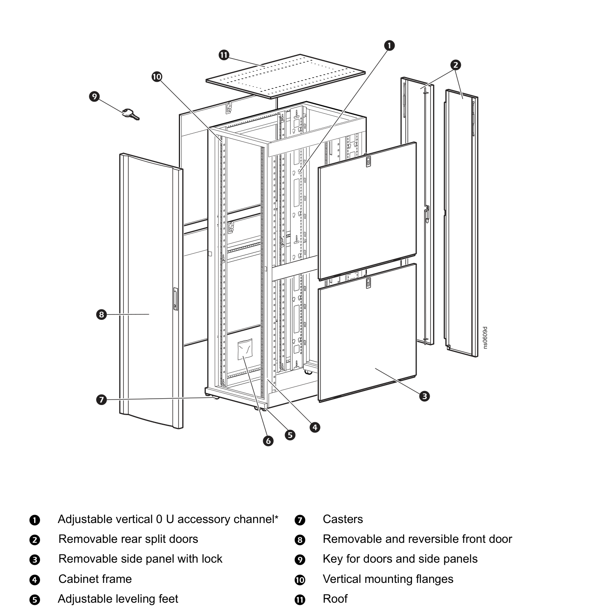
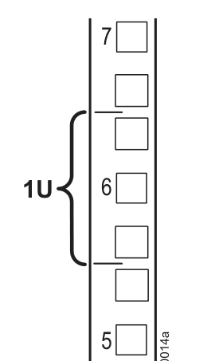
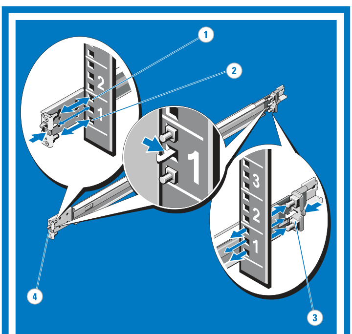
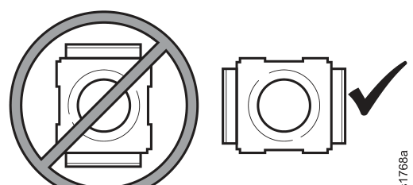
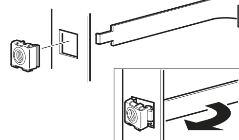
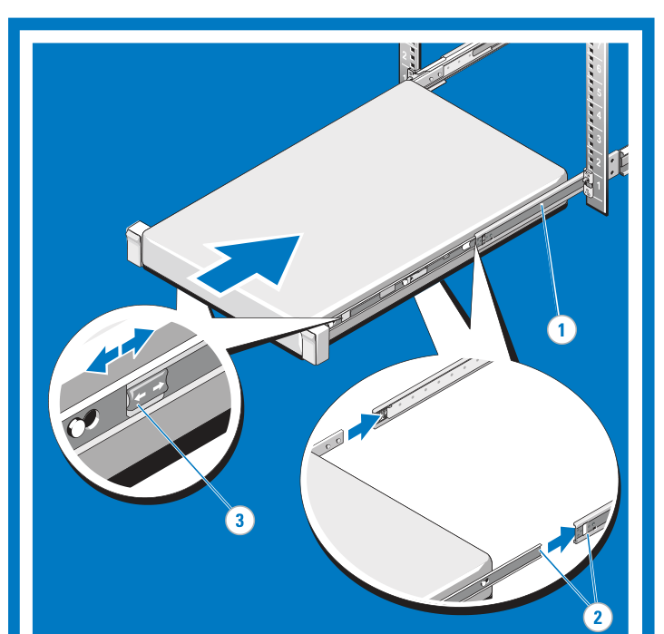
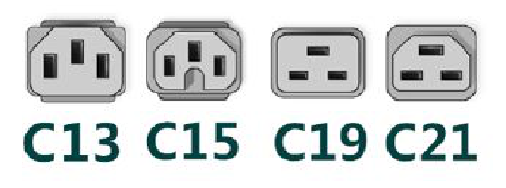

# 機櫃、滑軌與電源線｜上架前確認

> **用途：** 上架前確認機櫃空間、滑軌和供電都對得上，避免到現場才發現裝不上去。
> **原則：** 出發前先跟客戶確認**機櫃規格、剩餘 U 數、供電電壓與插座種類**。

## 1. 機櫃

| 項目 | 說明 |
|---|---|
| 寬度 | 標準 **19 吋** |
| 高度單位 | **1U = 44.45 mm（1.75 吋）**；常見機櫃 42U（見 1-1） |
| 立柱孔型 | **方孔**（最常見，配籠型螺帽）、**圓孔**、**螺紋孔** |
| 深度 | 伺服器 + 滑軌 + 後方理線需要的深度，**深的 2U 機器可能塞不進淺機櫃** |

機櫃各部位的名稱（以 APC NetShelter SX 為例），設備是鎖在 ⑩ **立柱（Vertical mounting flanges）** 上：

*圖片來源：[APC NetShelter SX Cabinet Installation and Customization Manual（990-2183J-001）](https://www.apc.com)，Component Identification*

### 1-1. U 是什麼

**U（Rack Unit）** 是機櫃的高度單位，**1U = 44.45 mm**。設備規格寫「1U」「2U」，就是它在機櫃裡佔幾格高度：

| 高度 | 常見設備 |
|---|---|
| 1U | 交換器、薄型伺服器（Dell R660、HPE DL360、Lenovo SR630）、PDU、配線面板 |
| 2U | 一般伺服器（Dell R760、HPE DL380、Lenovo SR650）、小型 NAS／儲存 |
| 4U 以上 | 塔式改機架、GPU 伺服器、大型儲存、UPS |

**怎麼在立柱上數 U：** 每 1U 有 **3 個孔**。立柱上**每 3 個孔印一個數字，數字標在那一格 U 的正中間**；數字上下各一個孔，三個孔合起來就是 1U。編號從下往上數。

*圖片來源：[APC NetShelter SX Cabinet Installation and Customization Manual（990-2183J-001）](https://www.apc.com)，Install the Equipment*

裝滑軌時，滑軌的掛勾要對準**同一格 U 的上下孔**。下圖是 Dell 滑軌裝進方孔立柱，立柱上印著 U 編號 1、2、3：

*圖片來源：[Dell Rack Installation Instructions（ReadyRails，0C380NA00）](https://dl.dell.com/manuals/all-products/esuprt_ser_stor_net/esuprt_equallogic/dell-dx6000g_setup%20guide_en-us.pdf)，步驟 2*

滑軌和設備要對齊 U 的分界裝，**不要跨在兩個 U 中間**，否則上下會卡到其他設備，多浪費一格。

### 1-2. 籠型螺帽（Cage Nut）與上架注意

方孔立柱要先裝**籠型螺帽**才能鎖螺絲（免工具滑軌不需要）。

- 籠型螺帽要**橫向裝**，兩邊的卡耳卡在方孔的**左右兩側**；**不要直向裝**（卡耳卡上下），容易鬆脫、設備掉落。
- 從機櫃**內側**裝進去：先勾住一邊卡耳，再用附的工具把另一邊撬進去。

*以上兩張圖片來源：[APC NetShelter SX Cabinet Installation and Customization Manual（990-2183J-001）](https://www.apc.com)，Cage nuts*

- **重的設備（UPS、儲存、2U/4U 伺服器）放下面**，輕的放上面，避免機櫃頭重腳輕翻倒。
- 機櫃還沒固定在地上時，**不要同時拉出兩台以上的設備**。
- 2U 以上的機器建議兩人搬。
- 記錄設備裝在第幾 U（從下往上數），寫進裝機紀錄。

## 2. 滑軌

- **免工具滑軌（Tool-less）**：直接卡進方孔或圓孔，最快。
- **螺紋孔機櫃**：免工具滑軌通常卡不進去，要用該廠牌的轉接件或螺絲固定式滑軌。
- 裝之前確認**前後方向、左右邊**（滑軌上有 FRONT / L / R 標示），兩邊要裝在**同一個 U 高度**。
- **理線臂（CMA）**：裝了之後機器可以在不拔線的情況下拉出來維修。

*圖片來源：[Dell Rack Installation Instructions（ReadyRails，0C380NA00）](https://dl.dell.com/manuals/all-products/esuprt_ser_stor_net/esuprt_equallogic/dell-dx6000g_setup%20guide_en-us.pdf)，步驟 5*

## 3. 電源線接頭

*圖片來源：[Dell PowerEdge R760 Installation and Service Manual](https://www.dell.com/support/manuals/en-us/poweredge-r760/per760_ism_pub/)，Figure 35*

| 接頭 | 額定電流 | 常見用途 |
|---|---|---|
| **C13 / C14** | 10A | 一般伺服器電源、交換器。電源供應器上的插座是 C14，線的那一頭是 C13 |
| **C15 / C16** | 10A | 跟 C13 很像，但多一個缺口；用在高溫環境的電源 |
| **C19 / C20** | 16A | 高瓦數電源（GPU 伺服器、大型儲存）、PDU 進線 |
| **C21 / C22** | 16A | 跟 C19 很像，但多一個缺口 |
| 一般插頭 | — | 接牆上插座或一般延長線；**台灣 110V 和 220V 的插座形狀不同** |

機櫃 PDU 的插孔多半是 C13 或 C19，所以機櫃內最常用的是 **C13 ↔ C14** 跳線，不是一般的家用插頭線。

以 Dell R760 為例，**電源瓦數不同，要用的線也不同**：

| 電源 | 電源線 |
|---|---|
| 700 W、800 W、1100 W、1400 W | C13 |
| 1800 W | C15 |
| 2400 W | C19 |
| 2800 W | C21 |

## 4. 電源供應器（PSU）

- **雙電源分別接不同的 PDU / UPS**，這樣其中一路斷電時機器不會停。兩條都接在同一條 PDU 等於沒有備援。
- 高瓦數電源在 **110V 時可輸出的功率會降低**。以 Dell R760 為例：1100 W、1400 W 的電源接 110V 只剩 **1050 W**；2400 W 的只剩 **1400 W**。要看電源上的規格標籤（通常會分別寫 100–127V 和 200–240V 的瓦數）。
- 同一台機器的兩顆電源要**同型號、同瓦數**。
- 驗收時可以拔掉一顆電源測試備援，BMC 應該要出現電源冗餘告警。
