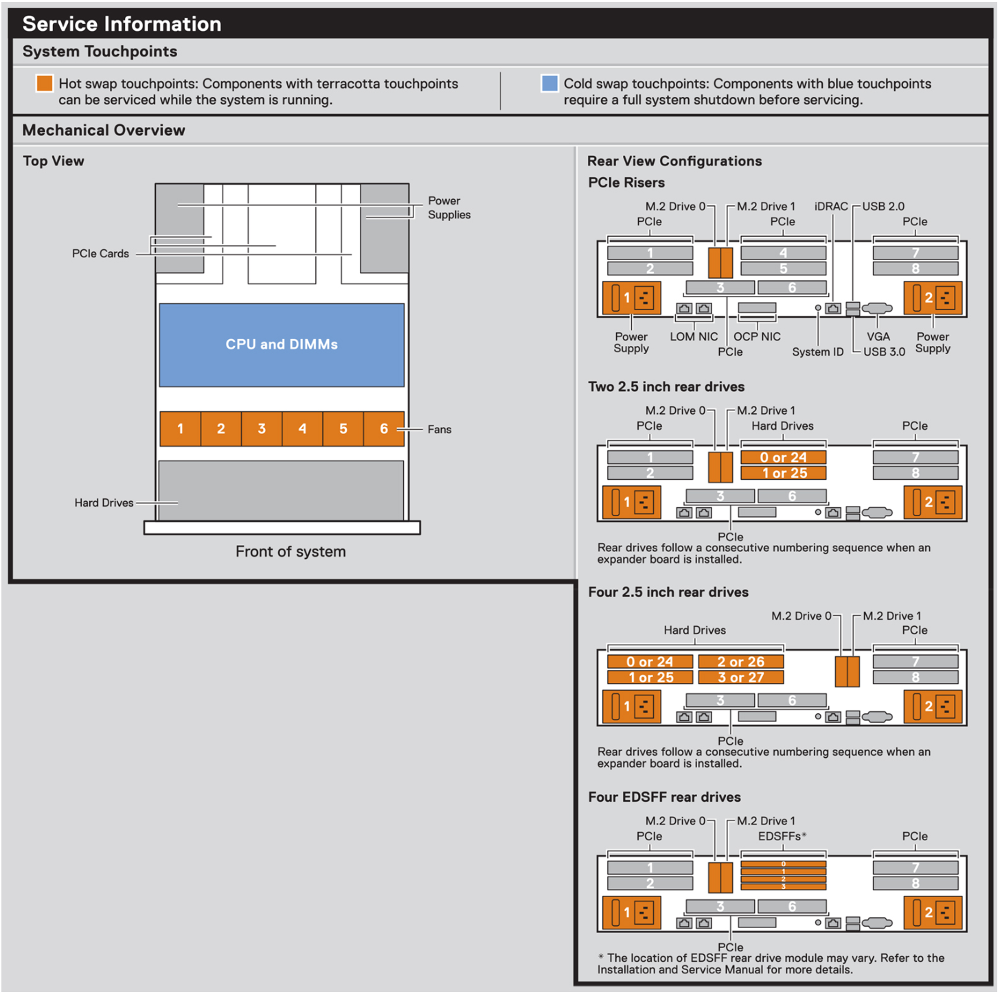

# 伺服器的 Slot（插槽）

> **用途：** 搞清楚「插在 Slot 3」到底是哪一個位置，裝卡、換硬碟、寫裝機紀錄時才不會講錯。

## 1. Slot 是什麼

**Slot（插槽）** 就是伺服器上讓零件插進去的位置，每個 Slot 都有編號。伺服器上常聽到的 Slot 有三種，**說「插在 Slot 3」之前要先講清楚是哪一種**：

| 種類 | 插什麼 | 編號長怎樣 | 在哪裡看編號 |
|---|---|---|---|
| **DIMM Slot**（記憶體插槽，Dell 叫 Socket） | 記憶體 | Dell：`A1`～`A16`、`B1`～`B16`；HPE：每顆 CPU `1`～`16`；Lenovo：`1`～`32` | 主機板上的印字、上蓋標籤 |
| **PCIe Slot**（擴充槽） | 網卡、RAID 卡、HBA、GPU | `Slot 1`、`Slot 2`…，多半在 **Riser**（轉接板）上 | 機器背面印字、上蓋標籤 |
| **Drive Slot／Bay**（硬碟槽） | 硬碟 | 多半從 `0` 開始 | 前面板印字、上蓋標籤 |

各種 Slot 的細節：

- DIMM Slot → [記憶體插法與上蓋標籤](../memory-population/index.md)
- Drive Slot → [硬碟種類與背板](../drives-and-bays/index.md)

## 2. 在上蓋標籤看 Slot 編號

下圖是 Dell R760 上蓋標籤的 Service Information 區塊：

- 右邊 **PCIe Risers**：背面 PCIe Slot **1～8** 的位置，以及 LOM、OCP 網卡、iDRAC 專用網路孔。
- 右邊下方：加裝後方硬碟時，後方硬碟槽的編號（例如 `0 or 24`），接在前面硬碟槽的編號後面。
- 左邊 **Top View**：上蓋打開後，電源、PCIe 卡、CPU 和記憶體、風扇 1～6、硬碟的位置。



*圖片來源：[Dell PowerEdge R760 Installation and Service Manual](https://www.dell.com/support/manuals/en-us/poweredge-r760/per760_ism_pub/)，Figure 20*

圖上的顏色也有意思：**橘色（terracotta）的零件可以開機狀態下熱插拔**（電源、風扇、硬碟），**藍色的要完全關機才能動**（CPU、記憶體）。

## 3. PCIe Slot 要注意的事

| 項目 | 說明 |
|---|---|
| **長度和寬度不一定一樣** | 插槽外觀是 x16，實際可能只接 x8 的線路。插高速卡（100G 網卡、GPU）前先查手冊確認是不是真的 x16 |
| **全高／半高** | 卡的擋板有全高（Full Height）和半高（Low Profile）兩種，要和 Riser 的槽位對得上 |
| **屬於哪顆 CPU** | 雙 CPU 機型，每個 PCIe Slot 接在其中一顆 CPU 上。**只裝一顆 CPU 時，部分 Slot 不能用** |
| **Riser 決定有哪些 Slot** | 同一台機器換不同的 Riser，Slot 數量和規格就不同 |

## 4. 裝機紀錄怎麼寫

寫清楚**哪一種 Slot ＋ 編號**，有 Riser 的話連 Riser 一起寫：

```text
25G 網卡：Riser 1 / PCIe Slot 2
RAID 卡：PCIe Slot 3
記憶體：A1～A8、B1～B8（共 16 支）
OS 硬碟：Drive Bay 0、1（RAID 1）
```

裝完可以在 BMC（iDRAC / iLO / XCC）的硬體清單確認每張卡被認在哪個 Slot，和紀錄對一下。
