# 光纖、光模組與線材｜現場辨識對照

> **用途：** 到客戶機房接線前，快速判斷「這條線、這顆模組、這個孔」能不能接在一起。
> **原則：** **線材種類、模組種類、兩端設備**三者要對得上。距離和相容性以模組標籤、設備規格書為準。

## 1. 單模 vs 多模

| 項目 | 單模（SMF） | 多模（MMF） |
|---|---|---|
| 等級 | OS1 / OS2 | OM1、OM2、OM3、OM4、OM5 |
| 外皮顏色（常見） | **黃色** | OM1/OM2 **橘色**、OM3/OM4 **水藍色**（OM4 偶爾是紫色）、OM5 **萊姆綠** |
| 芯徑 | 9/125 µm | 50/125 µm（OM1 是 62.5/125） |
| 波長 | 1310 / 1550 nm | 850 nm |
| 距離 | 公里等級（10 km、40 km…） | 數十到數百公尺 |
| 搭配模組 | LR、ER、LX… | SR、SX… |
| 常見用途 | 跨樓層、跨機房、ISP 進線 | 同機房、機櫃之間 |

- 外皮顏色是業界慣例，**不是保證**。以線身印字為準（例如 `OM4 50/125`、`OS2 9/125`）。
- **單模和多模不能混接**。接錯不一定完全不通，但會不穩定、掉封包，這種狀況最難查。

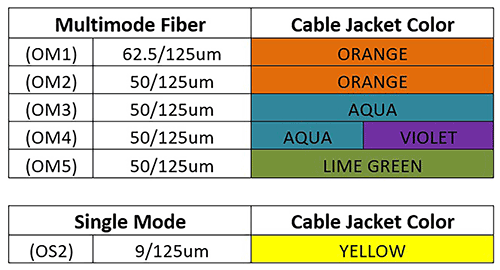

*圖片來源：[Black Box：Understanding Fiber Optic Cable and Connector Colors](https://www.blackbox.com/insights/blogs/tps/2022/01/25/understanding-fiber-optic-cable-and-connector-colors)*

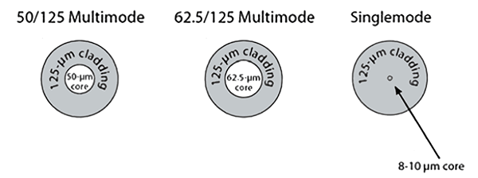

*圖片來源：[Black Box：Understanding Fiber Optic Cable and Connector Colors](https://www.blackbox.com/insights/blogs/tps/2022/01/25/understanding-fiber-optic-cable-and-connector-colors)*

單模的芯非常細（8～10 µm），所以要用雷射、可以傳很遠；多模的芯粗，光會走多條路徑，距離比較短。

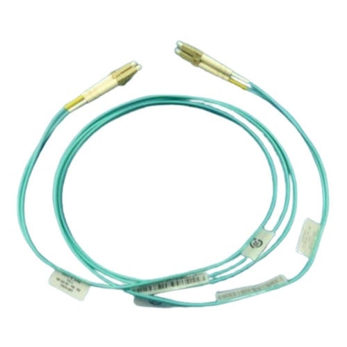

*圖片來源：[Dell：OM4 LC-LC Fiber Optic Cable](https://www.dell.com/en-us/shop/p/APD/470-ACLT/)*

## 2. 接頭種類

| 接頭 | 外觀 | 常見在哪 |
|---|---|---|
| **LC** | 小方頭，兩芯並排（Duplex） | 伺服器網卡、交換器的 SFP 模組，**最常見** |
| **SC** | 大方頭，插拔式 | 舊設備、配線箱、ISP 終端 |
| **MPO / MTP** | 扁長型，一個接頭 8～24 芯 | 40G / 100G QSFP 模組、高密度配線 |

接頭本體的顏色也有慣例：**藍色**＝單模 UPC、**綠色**＝單模 APC、**米色／黑色／水藍色**＝多模。
**APC（綠色）和 UPC（藍色）不能對接**，端面角度不同。

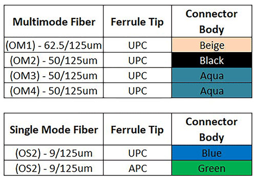

*圖片來源：[Black Box：Understanding Fiber Optic Cable and Connector Colors](https://www.blackbox.com/insights/blogs/tps/2022/01/25/understanding-fiber-optic-cable-and-connector-colors)*

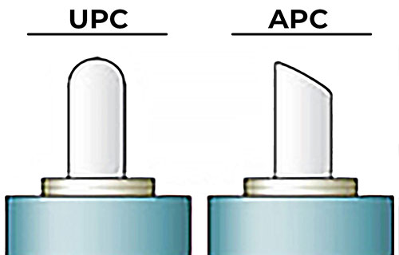

*圖片來源：[Black Box：Understanding Fiber Optic Cable and Connector Colors](https://www.blackbox.com/insights/blogs/tps/2022/01/25/understanding-fiber-optic-cable-and-connector-colors)*

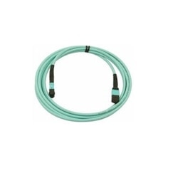

*圖片來源：[Dell：MPO Type B Crossover Cable, OM4](https://www.dell.com/en-us/shop/p/APD/470-ABPN/)*

### 2-1. 跳線規格怎麼看（LC-LC 是什麼意思）

跳線的名稱就是**「一端接頭－另一端接頭」＋ 單模／多模 ＋ 芯數 ＋ 長度**，例如：

```text
LC-LC  多模 OM4  雙芯  5M
LC/UPC-SC/UPC  單模 OS2  Duplex  10M
```

| 名稱裡的字 | 意思 | 怎麼選 |
|---|---|---|
| **LC-LC** | 兩頭都是 LC 接頭 | 伺服器 ↔ 交換器（兩邊都插 SFP 模組）**最常用** |
| **LC-SC** | 一頭 LC、一頭 SC | 一邊是 SFP 模組、另一邊是舊設備或 SC 孔的配線箱 |
| **雙芯（Duplex）** | 兩芯並在一起，一芯送、一芯收 | 一般模組都用雙芯 |
| **單芯（Simplex）** | 只有一芯 | BiDi（單芯雙向）模組才用 |
| **UPC / APC** | 端面研磨方式（藍色／綠色） | 跟對接的孔一樣；伺服器、交換器幾乎都是 UPC |
| **長度** | 3M、5M、10M… | 量過走線路徑再多抓一點，不要拉緊 |

**舉例：** 伺服器的 10G SR 模組接到同機櫃交換器的 10G SR 模組，距離 3 公尺 → 準備「**LC-LC 多模 OM3 或 OM4 雙芯 3M**」。

要接到機櫃的光纖配線箱時，先看配線箱面板是 LC 還是 SC，再決定是 LC-LC 還是 LC-SC。

## 3. 光模組（SFP / QSFP）

現場常把光模組統稱為 **GBIC**。GBIC（Gigabit Interface Converter）其實是早期體積較大的 1G 模組，SFP 是它的縮小版，所以也叫 **mini-GBIC**。現在用的幾乎都是 SFP 系列，跟廠商說「GBIC」對方聽得懂，但**下單或確認規格時要寫清楚**：

```text
10G  SFP+  SR  多模  850nm  LC
（速度）（尺寸）（類型）（光纖）（波長）（接頭）
```

### 3-1. 尺寸與速度

| 模組 | 速度 | 備註 |
|---|---|---|
| SFP | 1G | |
| SFP+ | 10G | 伺服器最常見 |
| SFP28 | 25G | 大多可以插 SFP+ 跑 10G，要看設備 |
| QSFP+ | 40G | 常用 MPO 接頭 |
| QSFP28 | 100G | 可用 QSA 轉接頭插 SFP+，要看設備 |

### 3-2. 型號代碼怎麼看

| 代碼 | 光纖 | 例子 |
|---|---|---|
| **SR**（Short Reach） | 多模 | 10GBASE-SR、25GBASE-SR |
| **LR**（Long Reach） | 單模 | 10GBASE-LR，約 10 km |
| **ER**（Extended Reach） | 單模 | 約 40 km |
| **SX / LX** | 1G 時代的名稱，SX＝多模、LX＝單模 | 1000BASE-SX |

**兩端模組要同一種**：一端 SR、另一端 LR 不會通。

多模距離會因等級而不同，例如 10G SR 在 OM3 約 300 m、OM4 約 400 m；25G、100G SR 的距離短很多（約 70～100 m）。長距離或不確定時，查模組規格。

### 3-3. 辨識模組

- **看標籤**：模組側面會印型號、波長（850 nm＝多模；1310 nm／1550 nm＝單模）、廠牌料號。
- **拉環（Bail）顏色**：很多廠商用黑色或米色代表 SR、藍色代表 LR，但**各家不統一**，以標籤為準。

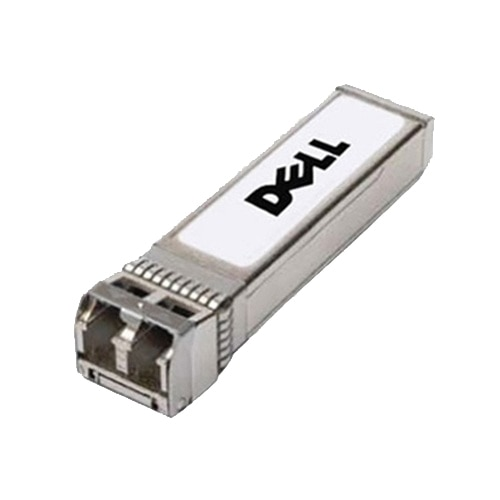

*圖片來源：[Dell：SFP+ 10GbE SR Transceiver](https://www.dell.com/en-us/shop/p/APD/407-BBOU/)*

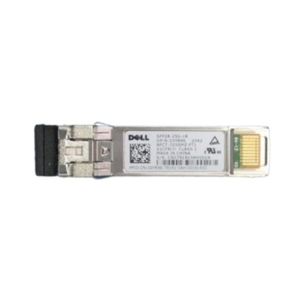

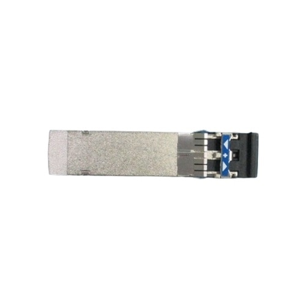

*以上兩張圖片來源：[Dell：SFP28 25GbE LR Transceiver](https://www.dell.com/en-us/shop/p/APD/407-BBXZ/)*

### 3-4. 原廠鎖（相容性）

部分交換器、網卡只認自家或認證過的模組。插了副廠模組可能出現 **unsupported transceiver**、Port 被關閉，或沒有任何反應。

- 出發前先確認：客戶的交換器和伺服器網卡是哪個廠牌、模組由誰提供。
- 有疑慮時多帶一顆原廠模組或相容碼正確的模組。

## 4. 不用光纖的選擇：DAC / AOC / RJ45

| 種類 | 說明 | 距離 |
|---|---|---|
| **DAC**（銅纜直連） | 兩端直接是 SFP+/SFP28 頭，不用另外買模組 | 被動式約 5 m 內，主動式再長一些 |
| **AOC**（主動光纜） | 兩端模組和光纖做成一條，不能拆 | 可到數十公尺 |
| **RJ45（10GBASE-T）** | 一般網路線接口 | Cat6A 可跑 10G 到 100 m |

- **SFP+ 孔和 RJ45 10GBASE-T 孔不能直接用網路線互接**，要用 10GBASE-T 的 SFP+ 電口模組（發熱大，不一定被設備支援）或改用同一種介面。
- 網路線：Cat5e 跑 1G；Cat6 跑 10G 約 55 m 內；Cat6A 跑 10G 到 100 m。
- DAC 一樣可能有原廠鎖問題。

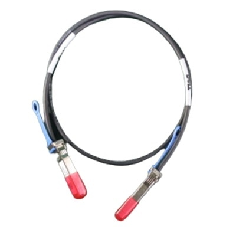

*圖片來源：[Dell：SFP+ to SFP+ 10GbE Copper Twinax Direct Attach Cable](https://www.dell.com/en-us/shop/p/APD/470-AAVH/)*

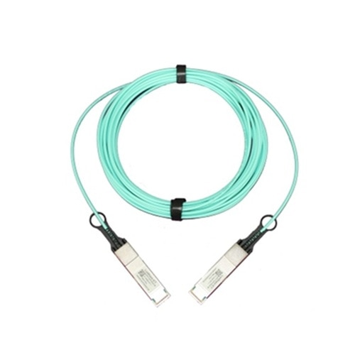

*圖片來源：[Dell：QSFP28 100GbE Active Optical Cable](https://www.dell.com/en-us/shop/p/APD/470-ACLU/)*

## 5. 接線注意事項

- **Tx / Rx**：雙芯光纖一芯送、一芯收。燈不亮時，**先把其中一端的兩芯對調**再插回去。
- **防塵蓋**：模組和跳線沒接時蓋上；髒污會造成訊號衰減。有清潔筆的話，插之前先清一下。
- **彎曲半徑**：光纖不要折死角、不要被束帶勒緊或被機櫃門夾到。
- **雷射安全**：不要直視模組或光纖端面。

## 6. 燈不亮怎麼查 {#link-down}

依序檢查：

1. 兩端模組是不是同一種（SR 對 SR、LR 對 LR）？
2. 光纖種類是否符合模組（SR 配多模、LR 配單模）？
3. Tx / Rx 對調試試看。
4. 兩端速度是否一致（例如一端 25G、一端 10G，可能要手動指定速度）？
5. 設備有沒有顯示 unsupported transceiver（原廠鎖）？
6. 換一條已知正常的跳線或模組交叉測試。

可以在主機上看模組資訊和收光功率（DOM）：

```bash
# 在 Linux 主機執行（eth0 換成實際網卡名稱）
ethtool eth0        # Link detected 是否為 yes、速度多少
ethtool -m eth0     # 模組型號、波長、收發光功率（需模組支援 DOM）
```
