# Synology RS1221RP+ 安裝與設定流程

- 設定日期：2026-10-02
- 帳號密碼：**不放在本網站**，請見公司密碼管理工具／原始帳密紀錄檔
- IP 位址：本頁為**範例值**，截圖中的 IP 已遮蔽；實際位址請見公司內部紀錄

## 設定總覽

| 項目 | 設定值 |
| --- | --- |
| 產品型號 | RS1221RP+ |
| 系統名稱 | rs1221rp |
| DSM 版本 | DSM 7.4.1-90080 |
| 管理介面 | `https://192.168.1.1:5001`（範例） |
| 管理員帳號 | test |
| IP / 遮罩 | 192.168.1.1（範例） / 255.255.128.0 |
| 閘道器 / DNS | 192.168.0.254（範例） / 8.8.8.8 |
| 硬碟 | 8 × Synology HAT5320-4T (3.6 TB) |
| 儲存集區 1 | RAID 5，硬碟 1–7，描述 `r5`，估計容量 22294 GB |
| 儲存空間 1 | 22000 GB，Btrfs，描述 `vol1` |
| Hot Spare | 硬碟 8 |
| 空間回收排程 | 週六、週日 00:00–01:00 |
| RAID Resync 速度 | 盡快完成 RAID Resync |

---

## 1. 初始設定：裝置名稱與管理員帳號

- 裝置名稱：`rs1221rp`
- 管理員帳號：`test`
- 未勾選「在 Web Assistant 中顯示」

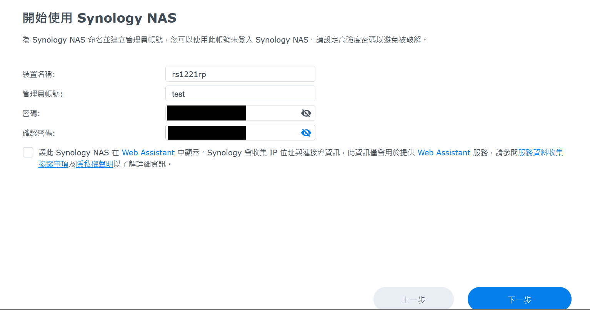

## 2. 網路設定：IPv4 手動設定

控制台 → 網路 → 網路介面 → 編輯 → IPv4，選「手動設定網路組態」：

- IP 位址：`192.168.1.1`（範例）
- 子網路遮罩：`255.255.128.0`（/17）
- 閘道器：`192.168.0.254`（範例）
- DNS：`8.8.8.8`
- MTU 維持預設 1500，未啟用 VLAN

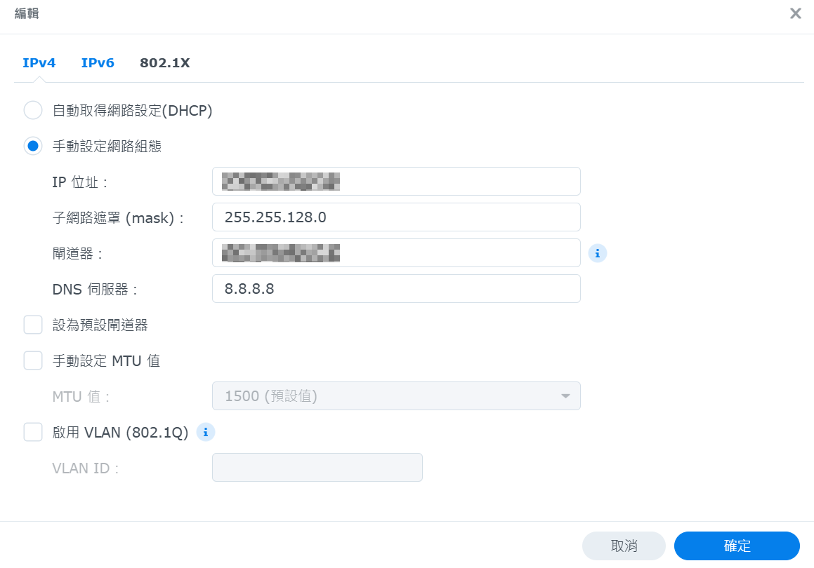

## 3. 建立儲存集區：RAID 類型

儲存空間管理員 → 新增 → 設定儲存集區屬性：

- RAID 類型：**RAID 5**（最少 3 顆，可容錯 1 顆）
- 儲存集區描述：`r5`

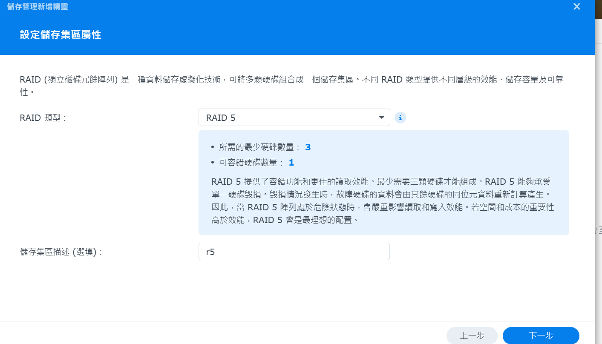

## 4. 選擇硬碟

勾選 **硬碟 1–7**，硬碟 8 保留給 Hot Spare。估計容量 21.8 TB（6 × 3.6 TB）。

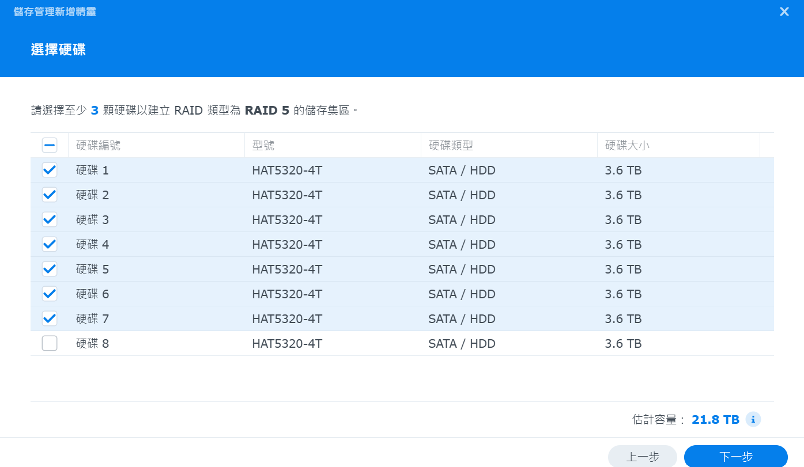

## 5. 配置儲存空間容量

- 總容量 22294.8 GB，配置 **22000 GB**（保留約 294 GB 未配置）

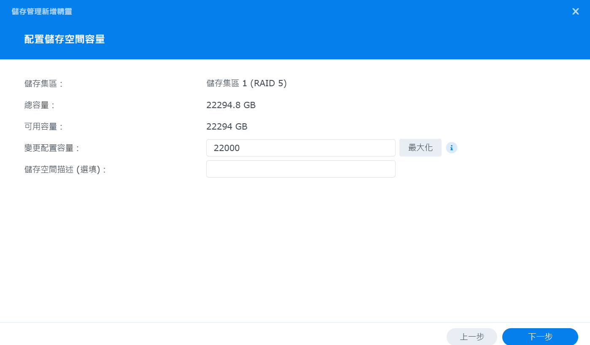

## 6. 儲存空間描述

- 儲存空間描述：`vol1`

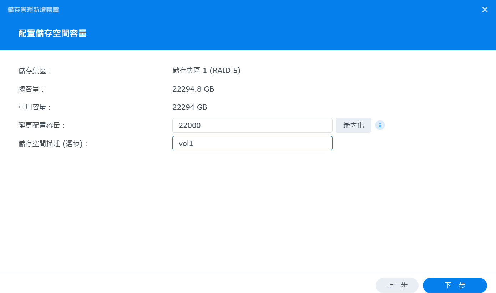

## 7. 再次檢查設定並套用

確認內容：RAID 5、SATA HDD、硬碟 1–7、配置 22000 GB、`vol1`、檔案系統 **Btrfs**，按「套用」。

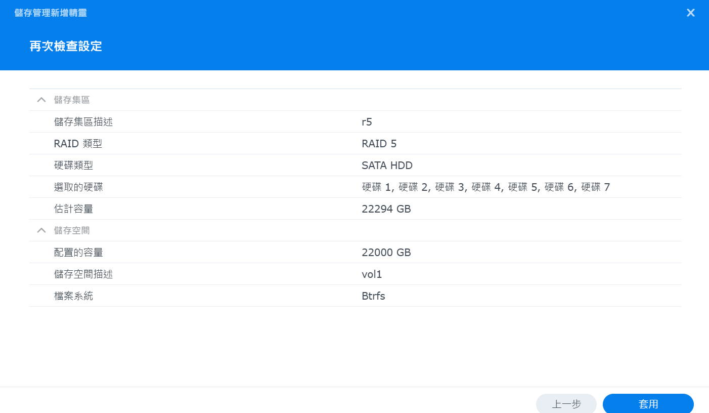

## 8. 指定 Hot Spare 硬碟

Hot Spare 建立精靈：

- 步驟 1：保護 **儲存集區 1**（RAID 5）
- 步驟 2：指定 **硬碟 8** 為 Hot Spare

RAID 5 中有硬碟故障時，硬碟 8 會自動接手重建。

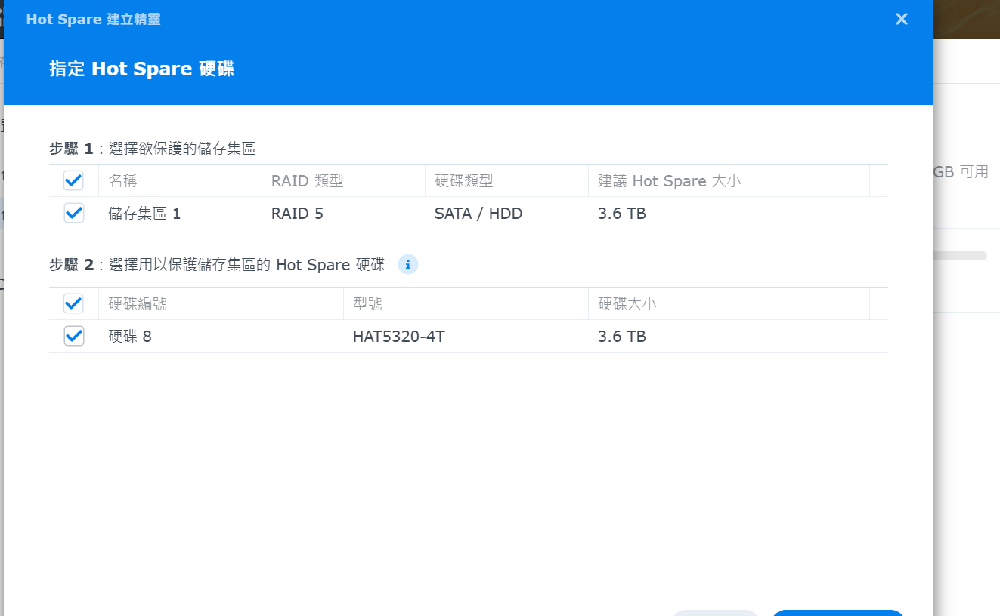

### 補充：什麼是 Hot Spare？

**Hot Spare**（中文叫「熱備援硬碟」或「熱備用硬碟」，有時簡寫 **HS**）是一顆已經插在 NAS 裡、通電待命、但平常不存資料的硬碟。

- **Hot（熱）**：硬碟已經裝在機器裡、處於通電待命狀態，不用關機、不用人去換。
- **Spare（備用）**：平常不參與 RAID，不存資料，只是在旁邊等。

**運作方式：**

```text
正常時：  [1][2][3][4][5][6][7] = RAID 5      [8] = 待命
硬碟 3 壞：[1][2][X][4][5][6][7] = 降級（Degraded），已經沒有容錯
自動接手：[1][2][8][4][5][6][7] = 開始重建，重建完成後恢復可容錯 1 顆
```

**為什麼要空出一顆做 Hot Spare：**

1. **RAID 5 只能容錯 1 顆。** 壞一顆後，陣列就進入「降級」狀態。這時候如果再壞第二顆，**整個儲存集區的資料都會遺失**。
2. **降級的時間越短越安全。** 如果沒有 Hot Spare，要等人發現、買硬碟、到機房換上，可能要好幾天；有 Hot Spare 的話，故障當下就自動開始重建。
3. **重建時壓力最大。** 重建要讀取其他所有硬碟，同一批買的硬碟這時候比較容易接連出問題，所以越早開始、越快完成越好。這也是第 10 步把 RAID Resync 設成「盡快完成」的原因。
4. **代價是少一顆的容量。** 8 顆裡有 1 顆待命、1 顆份量用在同位元（Parity），實際可用容量大約是 6 × 3.6 TB ≈ 21.8 TB。

壞掉的那顆硬碟換上新的以後，記得再把新硬碟設為 Hot Spare，保持隨時有一顆待命。

### Hot Spare 不是 HA

**HA** 是 **High Availability（高可用性）**，在 Synology 指的是 **Synology High Availability (SHA)**，跟 Hot Spare 是兩回事：

| | Hot Spare | HA（High Availability） |
| --- | --- | --- |
| 保護對象 | **硬碟**故障 | **整台 NAS** 故障（主機板、系統、網路等） |
| 需要的設備 | 同一台 NAS 多一顆硬碟 | **兩台**相同的 NAS，一台主、一台備援 |
| 運作方式 | 備用硬碟自動加入 RAID 重建 | 主機掛掉時，服務自動切換到備援主機 |
| 這台有沒有設定 | ✅ 有（硬碟 8） | ❌ 沒有 |

簡單說：Hot Spare 是「**備用硬碟**」，HA 是「**備用整台主機**」。

## 9. 全域設定：空間回收排程

儲存空間管理員 → 設定（全域設定）→ 空間回收排程 → 設定時間表格：

- 只在 **週六、週日 00:00–01:00** 執行空間回收（離峰時段）
- 未在時段內完成的話，會在下一個允許時段繼續

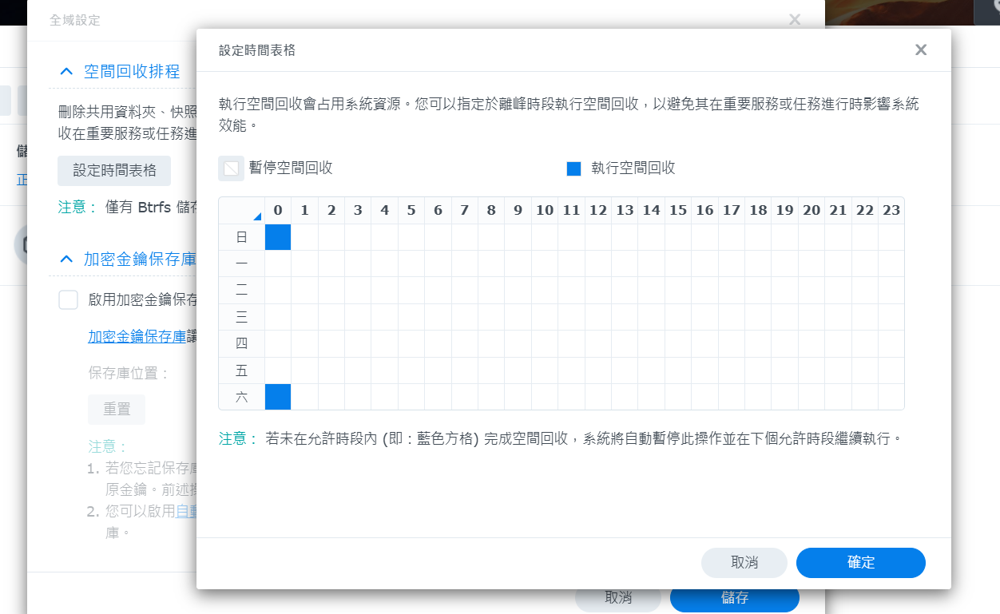

## 10. 全域設定：RAID Resync 速度限制

- 選擇「**盡快完成 RAID Resync**」
- 此設定也會影響 Data Scrubbing、修復、擴充儲存集區與變更 RAID 類別的速度；Resync 期間系統效能會較低

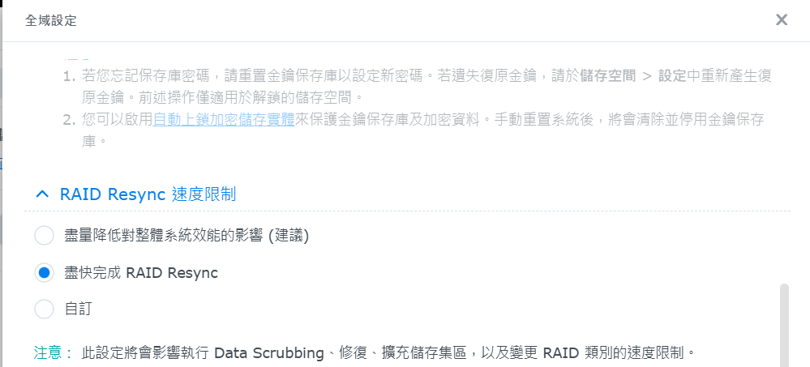

## 11. 確認硬碟狀態

儲存空間管理員 → HDD/SSD：

- 硬碟 1–7：儲存集區 1，狀態良好
- 硬碟 8：Hot Spare，狀態良好
- 溫度 29–31 °C，韌體版本 1401

| 硬碟 | 序號（範例） | 用途 |
| --- | --- | --- |
| 1 | `EXAMPLE-SN-01` | 儲存集區 1 |
| 2 | `EXAMPLE-SN-02` | 儲存集區 1 |
| 3 | `EXAMPLE-SN-03` | 儲存集區 1 |
| 4 | `EXAMPLE-SN-04` | 儲存集區 1 |
| 5 | `EXAMPLE-SN-05` | 儲存集區 1 |
| 6 | `EXAMPLE-SN-06` | 儲存集區 1 |
| 7 | `EXAMPLE-SN-07` | 儲存集區 1 |
| 8 | `EXAMPLE-SN-08` | Hot Spare |

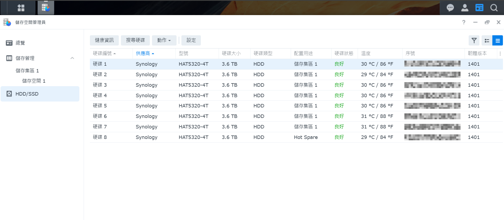

## 12. 確認系統資訊

控制台 → 資訊中心 → 一般：

- 系統名稱：rs1221rp
- DSM 版本：7.4.1-90080
- 產品序號：`EXAMPLE-SN-NAS01`（範例）
- 產品型號：RS1221RP+
- CPU：AMD Ryzen V1500B，2.2 GHz，4 核心
- 記憶體：16 GB
- 電源供應器 1、2：良好
- 散熱狀態：正常；風扇模式：靜音模式
- Synology 帳戶與 QuickConnect ID：未設定

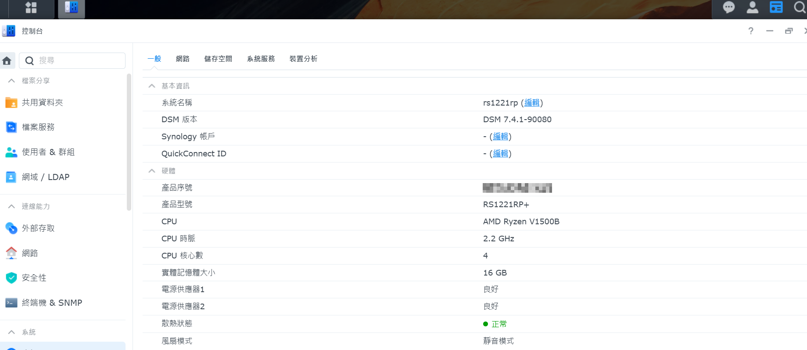
