# iSCSI + LVM Lab｜實作與客戶部署筆記

> **第 3 份筆記（獨立文件）**：接續 [第 1 份：PVE 安裝](../pve-install-m4/index.md) 與 [第 2 份：Debian + NFS Lab](../nfs-storage/index.md)。這裡只記錄 iSCSI + LVM 的操作、判讀和客戶部署時的調整。  
> **本次完成：** iSCSI Target／LUN／ACL 設定、PVE 遠端磁碟辨識、LVM 建立與 Storage `active` 驗收。**尚未執行** VM 磁碟寫入、重開機後持久性、HA 故障接管驗收。

:::caution
不要把截圖中的 `/dev/sda`、IP、IQN 當成所有客戶都相同的固定值。
:::

## 1. Lab 目標和架構

### 為什麼要做這個 Lab？

企業客戶的虛擬化環境，VM 磁碟常放在 **SAN 儲存**（例如 Dell PowerVault、HPE MSA），或 NAS 切出來的 **iSCSI LUN**。做法是透過網路把「一整顆磁碟」交給 PVE，PVE 再用 **LVM** 切成一塊塊 VM 磁碟。多台 PVE 共用這顆磁碟，就是叢集做 VM 遷移、HA 的共享儲存基礎。

這個 Lab 用 Debian **扮演 SAN**，練習裝機時最容易出錯的幾個環節：

- 儲存端建立 LUN，並用 **ACL** 只授權給指定主機。
- PVE 端用 **IQN** 連線，並**確認看到的是正確那顆磁碟**。認錯磁碟就初始化，會直接毀掉資料。
- 在遠端磁碟上建立 LVM，再登錄成 PVE Storage。

**NFS（第 2 份）和 iSCSI + LVM（本篇）差在哪？**

| | NFS | iSCSI + LVM |
|---|---|---|
| 分享的是什麼 | **資料夾**（檔案層級） | **整顆磁碟**（區塊層級） |
| 常見設備 | NAS | SAN、NAS 的 iSCSI 功能 |
| PVE 可以放 | ISO、範本、備份、VM 磁碟 | VM 磁碟、容器磁碟（**不能**放 ISO、備份檔） |
| 適合 | ISO 庫、備份目的地、小型環境 | 正式環境的 VM 磁碟、搭配 SAN 的叢集 |
| 主要風險 | 權限、網路設定錯誤 | 認錯磁碟就初始化、ACL／IQN 對應錯誤 |

實務上兩種常**一起用**：VM 磁碟放 iSCSI／SAN，ISO 和備份放 NFS／NAS。

**目標：** Debian 提供一顆 20 GB iSCSI LUN，PVE 經網路連接，再將 LUN 建立成 LVM Volume Group，登錄為可管理 VM 磁碟的 Storage。

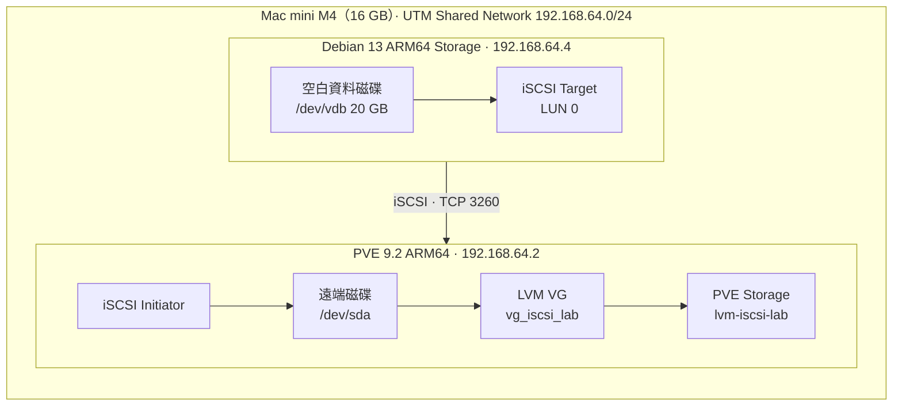

| 角色 | 本次 Lab | 到客戶現場可能不同 |
|---|---|---|
| 儲存端（Target） | Debian 13 ARM64 VM | NAS、SAN 或企業儲存陣列 |
| 用戶端（Initiator） | PVE `pve01` | 多台 PVE／其他 Hypervisor |
| 儲存端 IP | `192.168.64.4` | 客戶指定的 Storage VLAN／雙控制器 IP |
| PVE IP | `192.168.64.2` | 客戶管理網、儲存網常分開 |
| 後端儲存碟 | Debian `/dev/vdb` 20 GB | RAID／Storage Pool 提供的 LUN |
| PVE 看到的磁碟 | `/dev/sda` | `/dev/sdX` 或 Multipath `/dev/mapper/...` |
| Target IQN | `iqn.2026-09.lab.local:debian-storage` | 儲存設備實際提供的 IQN |
| Initiator IQN | 本次 PVE 實際查得 | **每一台主機需各自查詢** |
| 驗證方式 | 單節點、ACL、無 CHAP 的隔離 Lab | 視客戶需求設 CHAP、ACL、隔離網路與 Multipath |

**重要觀念：** Target＝提供儲存的設備；Initiator＝連線使用儲存的主機；LUN＝分享出去的區塊磁碟；IQN＝iSCSI 裝置識別名稱；LVM＝把磁碟變成可分配的儲存卷組。

## 2. Debian：新增與辨識 20 GB 資料磁碟

**在哪裡：** 在 Mac 上的 UTM 選 `Debian-Storage` → 關機 → 編輯 → Drives／磁碟機 → 新增一顆 **20 GB VirtIO Disk** → 儲存 → 開機。此步不在 PVE 做。

在 **Debian root Shell** 執行：

```bash
lsblk -o NAME,SIZE,FSTYPE,MOUNTPOINTS
lsblk -f /dev/vdb
```

判讀：`vda` 有 `/`、`/boot/efi`、`swap`，是系統磁碟；`vdb` 為 20 GB、沒有檔案系統和掛載點，才是本次 iSCSI 資料磁碟。**客戶現場不可依磁碟名稱猜測用途，必須對照容量、序號與 Storage LUN 對應。**

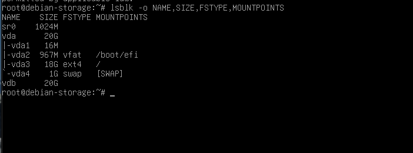
## 3. Debian：建立 Target 與 LUN

**在哪裡：** 全部在 Debian Storage Server 的 root Shell 操作。

先安裝套件：

```bash
apt update
apt install -y targetcli-fb
```

確認空白磁碟後進入設定工具：

```bash
lsblk -f /dev/vdb
targetcli
```

在 `targetcli` 內依序執行：

```text
/backstores/block create name=lab_lun dev=/dev/vdb
/iscsi create iqn.2026-09.lab.local:debian-storage
/iscsi/iqn.2026-09.lab.local:debian-storage/tpg1/luns create /backstores/block/lab_lun
ls
```

| 指令或名稱 | 本次用途 | 客戶現場怎麼決定 |
|---|---|---|
| `/dev/vdb` | 作為後端 20 GB 區塊磁碟 | 先核對指定 LUN／資料磁碟，切勿選 OS 磁碟 |
| `lab_lun` | 本地 Backstore 名稱 | 可依專案與用途命名 |
| `iqn.2026-09.lab.local:debian-storage` | Target 的唯一名稱 | 正式設備通常已提供，**不要自己亂改既有 IQN** |
| `lun0` | 第一個分享的 LUN | 以儲存設備的 LUN Mapping 設定為準 |
| `0.0.0.0:3260` | 本次預設監聽所有 IPv4 介面 | 正式環境限制 Storage 網段／ACL／防火牆 |

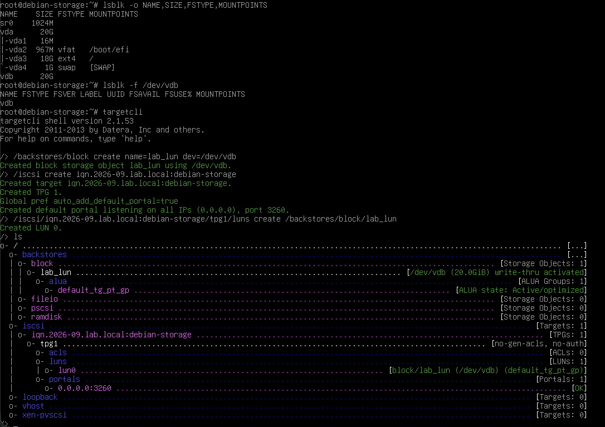
**怎麼判斷成功：** `ls` 樹狀清單有 `backstores/block/lab_lun`、`iscsi/指定 IQN/tpg1/luns/lun0` 和 `portals/0.0.0.0:3260 [OK]`。這時尚未代表 PVE 已取得存取權限。

## 4. Debian：設定只允許 PVE 的 ACL

先切換到 **PVE Shell** 查自己的 Initiator IQN：

```bash
apt install -y open-iscsi
cat /etc/iscsi/initiatorname.iscsi
```

本次查到的 Initiator IQN：`iqn.1993-08.org.debian:01:409f685b72c2`。**其他主機請用它自己的實際查詢結果。**

再切回 Debian 的 `targetcli`：

```text
/iscsi/iqn.2026-09.lab.local:debian-storage/tpg1/acls create iqn.1993-08.org.debian:01:409f685b72c2
ls
saveconfig
exit
```

在 Debian Shell 啟用開機自動還原已儲存的設定：

```bash
systemctl enable --now rtslib-fb-targetctl.service
systemctl is-enabled rtslib-fb-targetctl.service
```

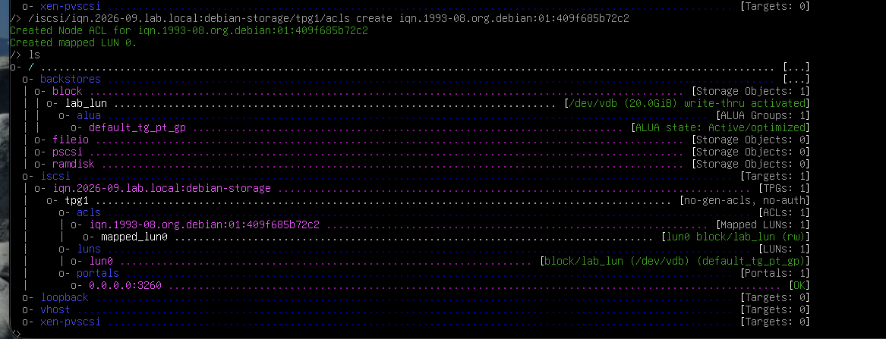
**看圖重點：** `acls` 有 PVE 的 IQN，下面有 `mapped_lun0`；`luns` 有 `lun0`；`portals` 是 `:3260`。[Debian iSCSI LIO Wiki](https://wiki.debian.org/SAN/iSCSI/LIO) 有 Debian 13 重開機還原服務的說明。

**資安提醒：** 本次 Target 顯示 `no-auth`，只用 IQN ACL 做存取限制；ACL 不是身分驗證。正式環境需考慮 CHAP、專用儲存網段、3260/TCP 防火牆與權限審核。

## 5. PVE：偵測 iSCSI 與加入 Storage

先在 **PVE Shell** 掃描：

```bash
pvesm scan iscsi 192.168.64.4
```

進入 PVE Web：**資料中心 → 儲存 → 新增 → iSCSI**：

| 欄位 | 本次設定 | 到客戶現場怎麼填 |
|---|---|---|
| ID | `iscsi-lab` | 自訂清楚的儲存識別名稱 |
| Portal | `192.168.64.4` | 儲存設備的 Target Portal IP／網段 |
| Target | `iqn.2026-09.lab.local:debian-storage` | 掃描出來且已授權的 Target IQN |
| 節點 | `pve01` | 真正允許使用該 LUN 的 PVE 節點 |
| 啟用 | 勾選 | 維護期間依計畫調整 |

新增後執行：

```bash
pvesm status
iscsiadm -m session
```

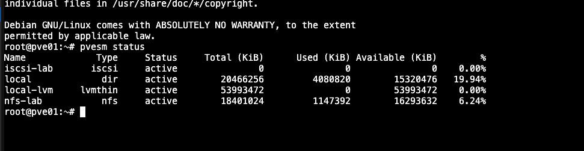
`iscsi-lab` 出現 `active` 但容量 0 是正常的：它代表發現與連線的 iSCSI 層，真正可配置容量會在後面的 LVM Storage 顯示。

## 6. PVE：確認遠端磁碟，避免初始化錯誤硬碟

在 **PVE Shell** 執行：

```bash
lsblk -o NAME,SIZE,TYPE,FSTYPE,MOUNTPOINTS
ls -l /dev/disk/by-path/ | grep iscsi
iscsiadm -m session
wipefs -n /dev/sda
pvs
```

本次觀察：PVE 系統碟是 `/dev/vda` 80 GB，iSCSI LUN 是 `/dev/sda` 20 GB。`/dev/disk/by-path/` 對照到 Target IQN、Portal、LUN 0 和 `../../sda`，才確認 **這次的 `/dev/sda` 是遠端磁碟**。`wipefs -n` 僅檢查簽章，不清除資料。

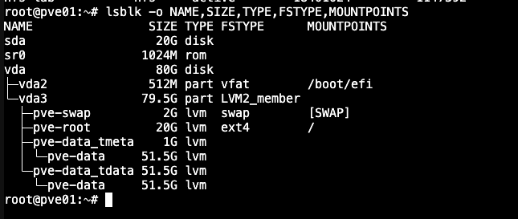
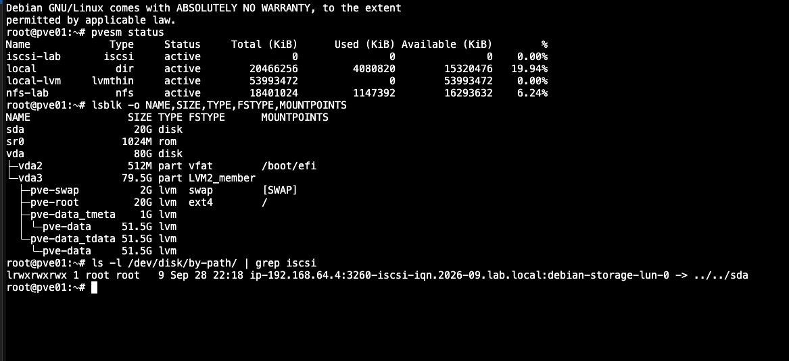
**客戶現場重點：** `/dev/sda` 可能隨重開機、掃描順序或多路徑而改變；需用 WWID、LUN ID、序號、by-path／multipath 交叉驗證。未核實前，**不得執行 `pvcreate`、`wipefs` 清除或任何格式化操作**。

## 7. PVE：建立 LVM Volume Group

只有在已確認 **本次 `/dev/sda` 是空白 iSCSI 測試 LUN** 後，才執行：

```bash
pvcreate /dev/sda
vgcreate vg_iscsi_lab /dev/sda
pvs
vgs
```

| 名詞 | 簡單意思 | 本次值 |
|---|---|---|
| PV（Physical Volume） | LVM 直接管理的磁碟 | `/dev/sda` |
| VG（Volume Group） | 把 PV 組成儲存池 | `vg_iscsi_lab` |
| LV（Logical Volume） | 從 VG 分配的虛擬磁碟 | 本次尚未建立 |

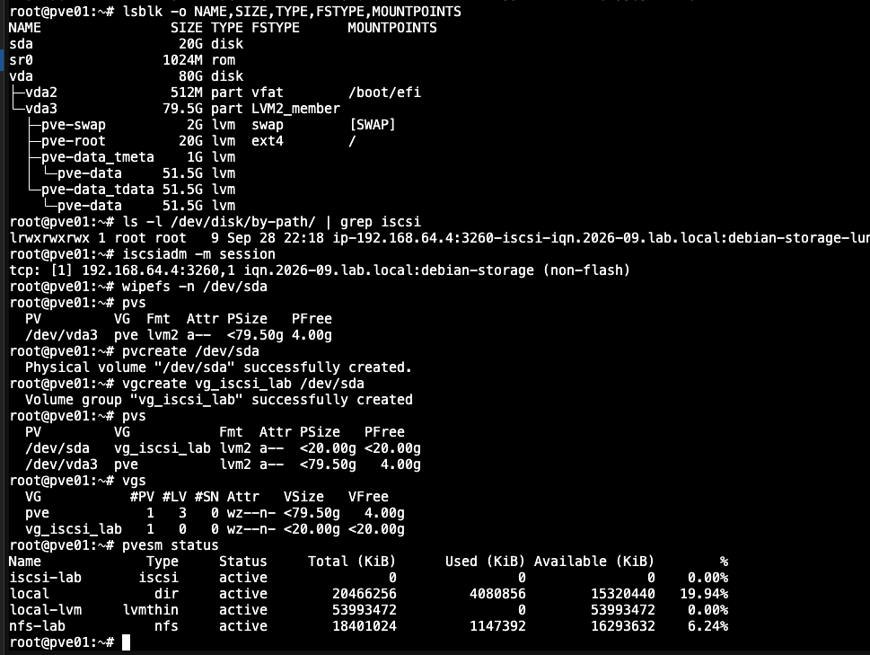
**結果怎麼看：** `pvs` 顯示 `/dev/sda` 隸屬 `vg_iscsi_lab`；`vgs` 顯示 VG 近 20 GB、`#PV=1`、`#LV=0`。`#LV=0` 代表還沒有建立虛擬磁碟，不是錯誤。

## 8. PVE：把現有 VG 登錄成 LVM Storage

**路徑：** PVE Web → **資料中心 → 儲存 → 新增 → LVM**。

本次已透過 CLI 完成 `pvcreate`、`vgcreate`，所以**不要再次用「基礎儲存：iscsi-lab」初始化同一顆 LUN**；改用「現有的磁碟群組」。

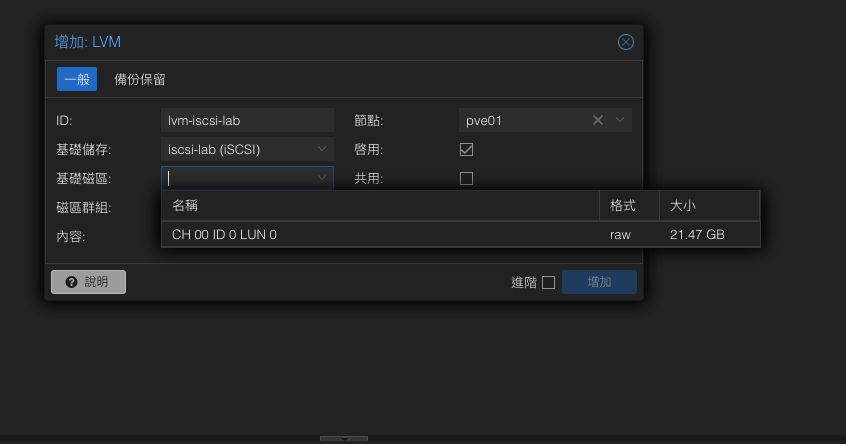
上圖是不同的操作模式：**若尚未建立 VG**，可依版本與流程從基礎 iSCSI LUN 建立；**本次已建立 VG**，應改用下圖的設定。

| 欄位 | 本次設定 | 客戶現場怎麼判斷 |
|---|---|---|
| ID | `lvm-iscsi-lab` | 自訂易辨識名稱 |
| 基礎儲存 | `現有的磁碟群組` | 已有 VG 才選此模式 |
| 磁碟群組 | `vg_iscsi_lab` | 選 `vgs` 可見且已核實的 VG |
| 內容 | `磁碟映像` | 依需求選 VM Disk／容器等 |
| 節點 | `pve01` | 只勾選有權存取此 LUN 的節點 |
| 啟用 | 勾選 | 正常使用時勾選 |
| 共用（Shared） | **不勾選** | 只有確認叢集、相同 LUN、受控共享設定時才評估 |
| 抹除已移除的磁區 | 不勾選 | 涉及資料清除與效能，依客戶政策 |

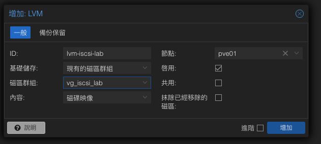
**Shared 常見誤解：** 勾選 Shared **不會自動把單一節點變成 HA**。多節點的共享 LVM 需要叢集協調、所有節點正確映射同一顆 LUN 與適當的儲存／多路徑規劃。未有這些條件，不要在客戶端照搬勾選。

## 9. 完成驗收：本次實際結果

在 PVE Shell：

```bash
pvesm status
pvs
vgs
```

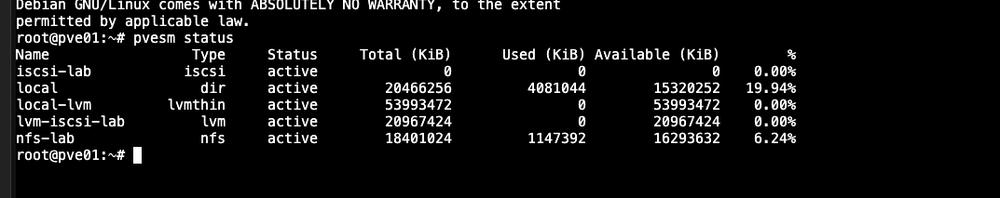
| 項目 | 本次結果 | 判讀 |
|---|---|---|
| `iscsi-lab` | `active`、容量 0 | iSCSI 連線／Storage 登錄正常，不直接顯示容量 |
| `lvm-iscsi-lab` | `active`、20 GB 左右 | 遠端 LUN 的 VG 已被 PVE 正常管理 |
| `nfs-lab` | `active` | 上一份筆記已另做 `NFS Lab OK` 讀寫測試 |
| `vg_iscsi_lab` | `#PV=1`、`#LV=0` | VG 已完成，本次**尚未做 iSCSI 實際資料寫入** |

### 重開機後驗收（尚未執行）

:::caution
這一項**還沒做**，下面是之後要照著做的步驟和判斷標準，不是本次結果。
:::

**重開順序：** 先開 Debian（Target），確認開機完成後再開 PVE，PVE 開機時才連得到 iSCSI。

| 檢查 | 在哪執行 | 指令 | 通過標準 |
|---|---|---|---|
| 還原服務有開機自動執行 | Debian | `systemctl status rtslib-fb-targetctl.service` | 顯示 `enabled`，狀態為 `active` |
| Target 設定還在 | Debian | `targetcli ls` | 仍有 `lun0`、PVE 的 ACL 與 `mapped_lun0`、portal `:3260` |
| PVE 自動連回 Target | PVE | `iscsiadm -m session` | 有一筆 `192.168.64.4:3260` 的 `iqn.2026-09.lab.local:debian-storage` |
| Storage 全部正常 | PVE | `pvesm status` | `iscsi-lab`、`lvm-iscsi-lab`、`nfs-lab` 都是 `active` |

四項都通過，才能把開頭摘要中的「重開機後持久性」改為已完成。若 Target 消失，先查第 10 節「遇到問題先在哪一層檢查？」。

## 10. 面對客戶時的部署前檢查清單

**不要只照抄 Lab IP 和磁碟名稱。** 到客戶現場，先把以下資料和儲存設備管理者核對：

| 要確認的資訊 | 為什麼要確認 |
|---|---|
| PVE Node 名稱／版本／Kernel | 確認相容性與節點範圍 |
| 儲存設備品牌／型號／韌體 | 決定適用文件及操作路徑 |
| Storage Portal IP、VLAN、MTU | 保證路由、交換器與儲存網路一致 |
| Target IQN、Initiator IQN | 避免設定錯誤設備及 ACL |
| LUN ID、容量、WWID／序號 | 避免初始化錯誤硬碟 |
| CHAP 認證／ACL／防火牆 | 確保授權、限制存取 |
| 單路徑或 Multipath | 決定故障備援及正式使用的裝置路徑 |
| 單節點或 PVE Cluster | 決定 Shared、鎖定、HA 與驗收範圍 |
| 現有資料與備份狀態 | 初始化前必須明確獲得授權 |

### 遇到問題先在哪一層檢查？

| 現象 | 優先檢查 |
|---|---|
| 掃描不到 Target | Portal IP、3260/TCP、Target 服務、交換器與防火牆 |
| 看得到 Target 但登入失敗 | Initiator IQN、ACL、CHAP 是否一致 |
| 登入成功但沒看到 LUN | Target 的 LUN Mapping／ACL mapped LUN、主機重新掃描 |
| `lsblk` 有磁碟，但不知哪顆 | `by-path`、WWID、序號、Multipath，切勿猜 `sdX` |
| iSCSI active、容量為 0 | 查看 LVM 是否另行登錄；這不一定是錯誤 |
| `vg_iscsi_lab` 存在但 Web 看不到 | `vgs`、PVE 儲存清單及 Node 限制；不要重複初始化 |
| 重開機後 Target 消失 | Debian 是否 `saveconfig`、啟用還原服務 |

## 11. 官方參考資料

- [Proxmox VE 9.x Administration Guide](https://www.proxmox.com/en/downloads/proxmox-virtual-environment/documentation/proxmox-ve-admin-guide-for-9-x)：Storage 中的 iSCSI 與 LVM 原理、Shared 限制。
- [Debian Wiki — SAN/iSCSI/LIO](https://wiki.debian.org/SAN/iSCSI/LIO)：Target 建立與 Debian 13 開機還原服務。
- [Debian targetcli 指令手冊](https://manpages.debian.org/testing/targetcli-fb/targetcli.8.en.html)：Backstore、LUN、ACL、設定儲存等指令。
