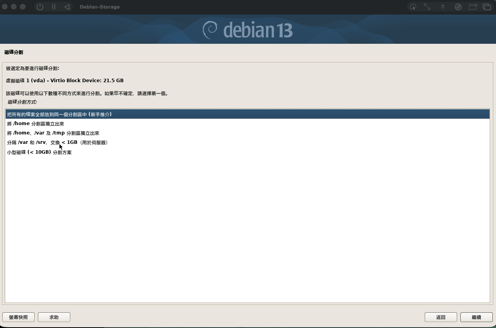
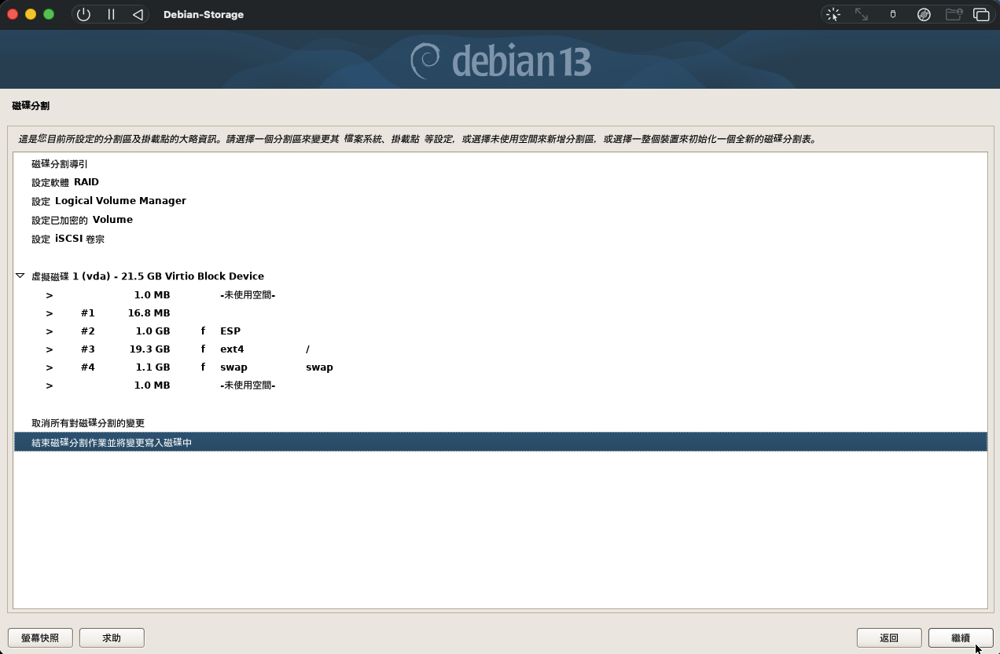
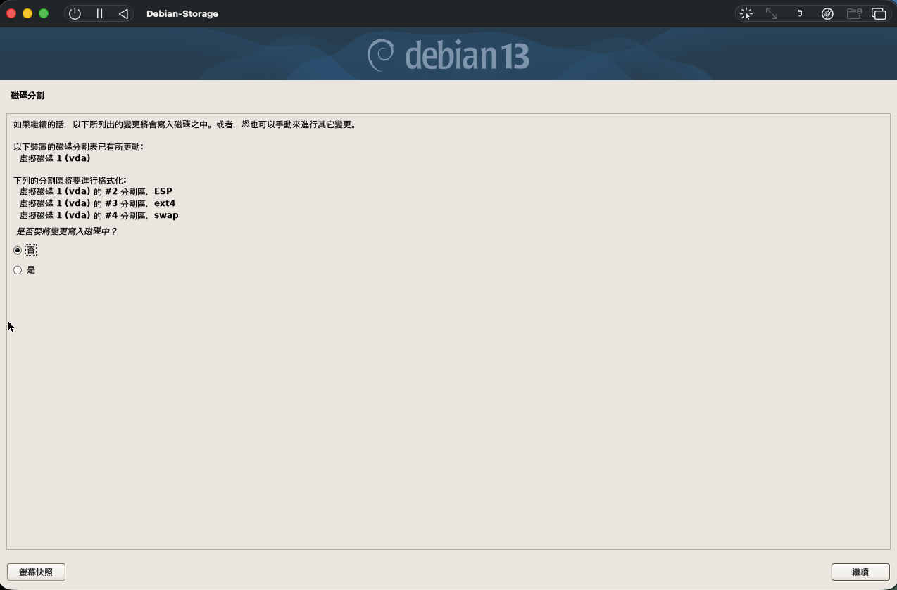
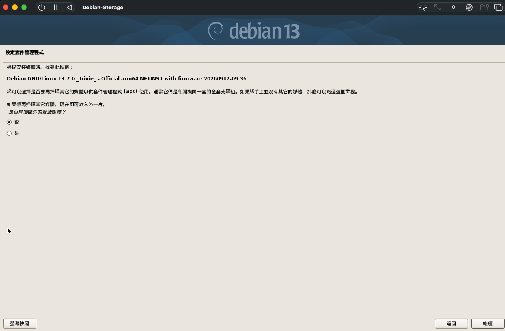
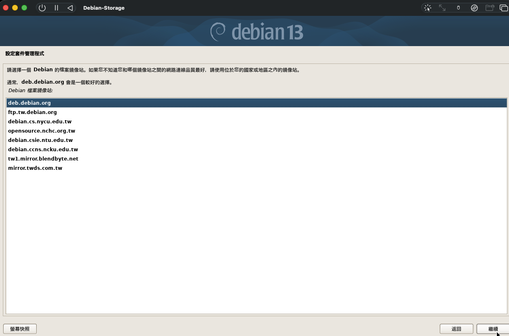
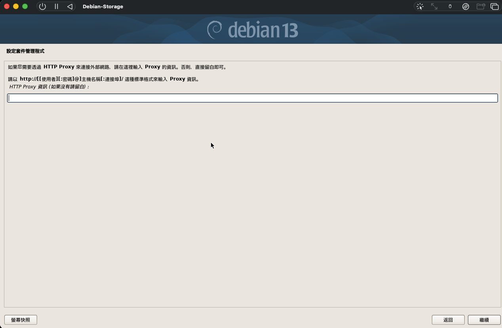
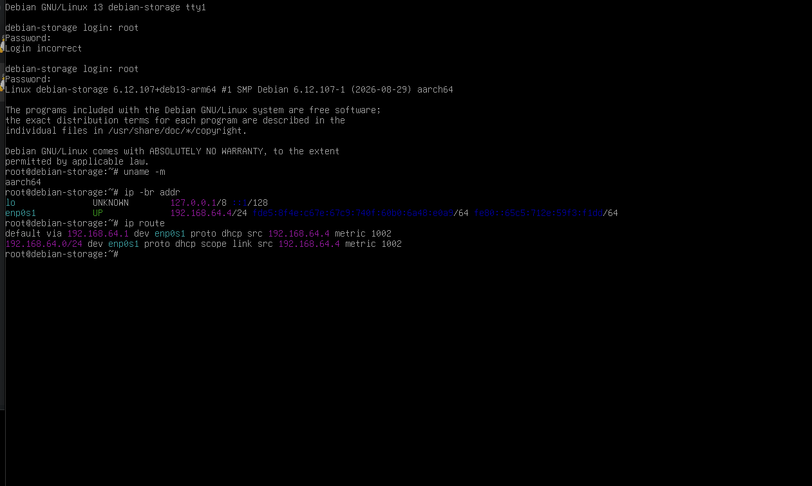
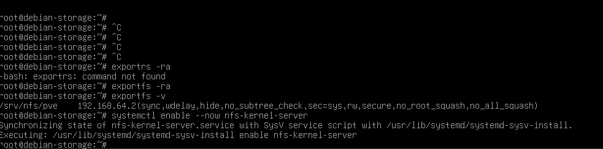
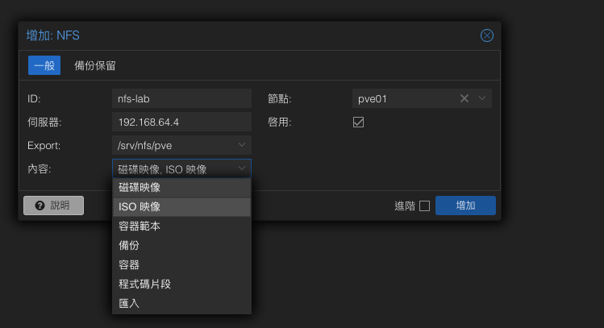

# Debian Storage + NFS Lab｜簡明實作筆記

> **第 2 份筆記：** 接續 [第 1 份：Mac M4 安裝 PVE](../pve-install-m4/index.md)。本篇只記錄 Debian Storage Server 和 NFS，不重複 PVE 安裝，也不包含尚未實作的 iSCSI。  
> **實作結果：** PVE 已成功掛載 Debian NFS，共享檔案讀取測試顯示 `NFS Lab OK`。  
> **環境：** Mac mini M4（16 GB）、UTM、PVE 9.2 ARM64、Debian 13 ARM64。

## 1. Lab 目標與架構

### 為什麼要做這個 Lab？

PVE 如果只用本機硬碟，ISO、備份、VM 都綁在那一台主機上，主機壞了資料也跟著出事。實務上，客戶多半會準備一台 **NAS**（例如 Synology、QNAP），把這些東西集中放到網路儲存上，而 **NFS 是 PVE 接 NAS 最常見、最好上手的方式**。

這個 Lab 用一台 Debian **扮演 NAS**，在沒有實體設備的情況下，練一次「儲存端分享資料夾 → 只允許 PVE 存取 → PVE 掛載 → 驗證讀寫」的完整流程。之後到現場遇到真的 NAS，操作介面不同，但**要設定的項目和檢查方式是一樣的**。

| 伺服器工程師實務上會遇到的情境 | NFS 的角色 |
|---|---|
| 客戶有多台 PVE，ISO／範本不想每台各傳一次 | 放在 NAS，所有 PVE 共用同一份 |
| 要幫客戶規劃 VM 備份 | PVE 的備份檔存到 NAS，主機故障時備份還在 |
| 客戶要做多台 PVE 的叢集 | VM 磁碟放在共享儲存，才能在主機之間搬移 VM；效能需求高時多改用 iSCSI／FC（見[第 3 份](../iscsi-lvm-storage/index.md)） |

**目標：** 在 UTM 額外安裝 Debian，提供 NFS 共用資料夾給 PVE，最後完成跨機讀寫驗證。

```text
Mac mini M4（16 GB）
└── UTM Shared Network：192.168.64.0/24
    ├── PVE（已完成） 192.168.64.2
    └── Debian Storage 192.168.64.4（DHCP，可能變動）
         └── 分享 /srv/nfs/pve（NFS）
```

**名詞簡單說：** Debian 是負責提供儲存的 Linux 伺服器；NFS 是透過網路分享「資料夾」的方式；PVE 是使用這份共享資料夾的主機。

## 2. 在哪裡安裝 Debian？

在 **Mac 的 UTM 主畫面**新增虛擬機，**不要裝在 PVE 裡**。因為目前 PVE 在 UTM 內檢測不到 `/dev/kvm`，先避免巢狀 VM。

### 2-1. 下載 ISO

前往 [Debian 官方安裝程式](https://www.debian.org/releases/stable/debian-installer/)，選 **ARM64 → netinst ISO**。本次畫面顯示 Debian GNU/Linux 13.7.0 ARM64 netinst。

### 2-2. UTM 建立 VM

`UTM → ＋ → Virtualize（虛擬化）→ Linux`，掛載 ARM64 ISO。建立完成後命名 `Debian-Storage`。

| 欄位 | 這次 Lab 建議值 | 為什麼 |
|---|---|---|
| CPU | 2 Core | NFS 小型練習夠用 |
| RAM | 2 GB | 保留記憶體給 PVE 和 macOS |
| 系統磁碟 | 20 GB（安裝畫面約 21.5 GB） | 只放 Debian 系統 |
| 網路 | Shared Network | 與既有 PVE 使用相同虛擬網路 |
| 網卡 | VirtIO | 虛擬網卡 |

建立 VM 的畫面與 [第 1 份：PVE 安裝 第 2 節](../pve-install-m4/index.md#2-在-utm-建立-pve-虛擬機) 相同，只是 ISO 換成 Debian ARM64。

網路選 **Shared Network**，設定畫面同 [第 1 份 第 2 節的「UTM 網路設定」](../pve-install-m4/index.md#2-在-utm-建立-pve-虛擬機)。

> 第二顆 20 GB 資料磁碟是**以後做 iSCSI** 才需要的項目。本次 Debian 安裝畫面只看得到一顆系統磁碟，沒有把第二顆列為已完成。

## 3. Debian 安裝畫面怎麼選

### 3-1. 系統磁碟分割

開機選 `Graphical install`，語言、時區依自己的環境設定。進入磁碟分割後，選擇 20 GB 左右的 **`vda` 系統磁碟**，並選「把所有檔案放到同一個分割區」。


確認分割摘要有 `ext4` 且掛載點為 `/`（root 根目錄），以及 EFI 開機分割區與 swap。畫面所示配置如下：

| 分割區 | 容量（畫面值） | 用途 |
|---|---:|---|
| `vda2` | 1.0 GB | ESP / EFI 開機 |
| `vda3` | 19.3 GB | ext4，系統根目錄 `/` |
| `vda4` | 1.1 GB | swap 交換空間 |


選「結束磁碟分割作業並將變更寫入磁碟」，下一頁選 **是**。只會格式化選定的 UTM 虛擬磁碟；若磁碟不是預期的 `vda`，先不要寫入。


### 3-2. 安裝媒體、鏡像站、Proxy

| 畫面 | 選擇 | 原因 |
|---|---|---|
| 掃描額外安裝媒體 | **否** | 只有這一個 Netinst ISO |
| Debian 鏡像站 | **`deb.debian.org`** | Debian 套件下載入口 |
| HTTP Proxy | **留空** | 家用網路不需要代理 |
| Software selection（若顯示） | SSH server、standard system utilities；不用桌面 | 作為輕量的儲存伺服器 |




安裝完畢後，**退出 Debian ISO 再重新啟動**，避免重新進入安裝程式。

退出 ISO 的操作畫面同 [第 1 份 第 4 節](../pve-install-m4/index.md#4-安裝完成卻又跳回安裝選單)：UTM 設定 → USB 磁碟機 → **清除**。

## 4. Debian 開機及網路確認

這次已使用 `root` 成功登入 Debian。於 **Debian 終端機**執行：

```bash
uname -m
ip -br addr
ip route
```

實際檢查結果：

| 項目 | 結果 |
|---|---|
| 架構 | `aarch64`（ARM64） |
| 主機名稱 | `debian-storage` |
| 網卡 | `enp0s1` |
| IP | `192.168.64.4/24` |
| 閘道 | `192.168.64.1` |
| IP 取得 | DHCP |


確認能與 PVE 溝通：

```bash
# 在 Debian 執行
ping -c 4 192.168.64.2

# 在 PVE Shell 執行
ping -c 4 192.168.64.4
```

> **注意：** `192.168.64.4` 目前由 DHCP 指派，重新開機後可能改變。長期使用前，應規劃 DHCP 保留或固定 IP，並同步檢查 NFS 伺服器與 PVE 的設定。

## 5. Debian 建立 NFS 共享資料夾

以下指令在 **Debian（不是 PVE）** 執行。

### 5-1. 安裝 NFS

```bash
apt update
apt install -y nfs-kernel-server nfs-common
```

### 5-2. 建立共享目錄

```bash
mkdir -p /srv/nfs/pve
chmod 755 /srv/nfs/pve
```

### 5-3. 只允許 PVE 掛載

```bash
nano /etc/exports
```

加入一行：

```text
/srv/nfs/pve 192.168.64.2(rw,sync,no_subtree_check,no_root_squash)
```

| 參數 | 白話說明 |
|---|---|
| `192.168.64.2` | 只允許本次 PVE IP |
| `rw` | 可讀、可寫 |
| `sync` | 依同步方式處理寫入 |
| `no_subtree_check` | 不檢查子樹路徑 |
| `no_root_squash` | 保留遠端 root 權限（**僅限受控 Lab**） |

> `no_root_squash` 權限較高，不要照搬到未經安全評估的客戶環境，也不要將 NFS 服務公開到網際網路。

### 5-4. 套用及檢查

```bash
exportfs -ra
exportfs -v
systemctl enable --now nfs-kernel-server
systemctl is-active nfs-kernel-server
```

這次的 `exportfs -v` 已列出 `/srv/nfs/pve` 與 `192.168.64.2`，代表匯出設定已生效。最後一條指令預期是 `active`；如果不是，要先檢查服務。


## 6. PVE 掛載 Debian NFS

回到 PVE 管理網頁：`https://192.168.64.2:8006`。依序點 **資料中心 → 儲存 → 新增 → NFS**。

| 欄位 | 本次設定 |
|---|---|
| ID | `nfs-lab` |
| 伺服器 | `192.168.64.4`（Debian） |
| Export | `/srv/nfs/pve` |
| 內容 | 磁碟映像、ISO 映像、備份 |
| 節點 | `pve01` |
| 啟用 | 勾選 |


按 **增加**，再在 PVE Shell 檢查：

```bash
pvesm status
findmnt -t nfs,nfs4
```

`nfs-lab` 應顯示 `active`，並能查到 NFS 掛載。


## 7. NFS 讀寫驗收（已完成）

**PVE Shell** 寫入：

```bash
echo "NFS Lab OK" > /mnt/pve/nfs-lab/test.txt
cat /mnt/pve/nfs-lab/test.txt
```

**Debian Shell** 讀取同一份檔案：

```bash
cat /srv/nfs/pve/test.txt
```

你這次已確認看到：

```text
NFS Lab OK
```

**這代表 PVE 已成功將測試文字寫到 Debian 提供的 NFS 目錄，而 Debian 也讀得到相同資料。** 這是本次 NFS Lab 的核心驗收結果。

---

**參考：** [Debian 安裝指南](https://www.debian.org/releases/stable/installmanual) · [Debian NFS Wiki](https://wiki.debian.org/NFSServerSetup) · [Proxmox VE 管理指南](https://pve.proxmox.com/pve-docs/pve-admin-guide.html)
